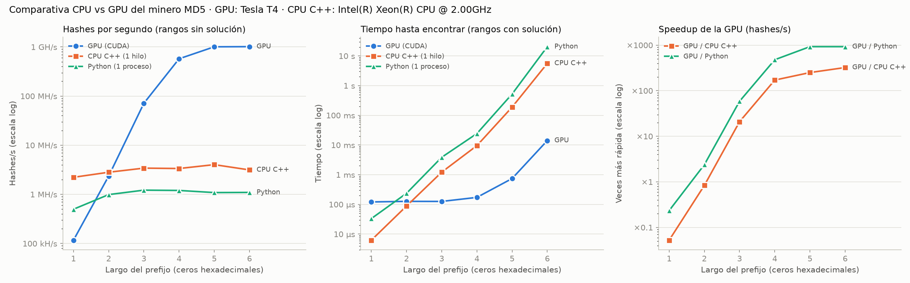

# Cierre del Pilar 1 — Comparativa CPU vs GPU (BC-10)

Una batería fija de casos que corre, con los mismos parámetros, en los tres mineros del [Hit 7](../hit7/). Los tres tienen la misma interfaz (`<cadena> <prefijo> <min> <max>`):

| Implementación | Binario | Qué es |
|---|---|---|
| `gpu` | [`hit7/pow_rango`](../hit7/pow_rango.cu) | CUDA, un hilo por nonce, tandas de 2^20 |
| `cpu` | [`hit7/pow_rango_cpu`](../hit7/pow_rango_cpu.cpp) | C++, un hilo |
| `python` | [`hit7/referencia.py`](../hit7/referencia.py) | `hashlib`, un proceso: el mismo bucle que usa cada proceso del minero CPU del Pilar 2 ([`minero_cpu/busqueda.py`](../../pilar2/minero_cpu/busqueda.py)) |

Los tres devuelven el **menor** nonce del rango, así que tienen que dar exactamente el mismo número.

## Cómo correrlo

```bash
cd pilar1/cierre
python3 bateria.py          # un solo comando: GPU, CPU C++ y Python, 3 repeticiones -> resultados.csv
python3 graficar.py         # tablas en Markdown + comparativa.png (necesita matplotlib)
```

- `bateria.py` compila `pow_rango` (`nvcc -arch=native`) y `pow_rango_cpu` (`g++`) si faltan o si su fuente es más nueva. Si no hay GPU, la saltea con un aviso y corre solo CPU.
- Opciones: `--impl gpu,cpu` (por defecto `gpu,cpu,python`), `--repeticiones 1`, `--largos 1-5`.
- Tarda unos 6 minutos con las 3 repeticiones. Python se lleva casi todo el tiempo: ~2 min por repetición.
- Termina con código 1 si alguna corrida no coincide con el resultado esperado.

En Colab:

```bash
!cd BlockChain-Distribuida && git pull
!cd BlockChain-Distribuida/pilar1/cierre && python3 bateria.py && python3 graficar.py
```

## La batería (`casos.csv`)

La generó [`generar_casos.py`](generar_casos.py) con `hashlib`, **no** con los mineros que se prueban. Así el resultado esperado de cada caso es independiente y sirve para verificar a los tres. Son 36 casos:

- **Prefijos** de ceros de largo 1 a 6.
- **Tres cadenas**, elegidas por cuántos bloques de 64 bytes de MD5 ocupa `cadena + nonce`:
  - `corta`: `bc10`, 1 bloque.
  - `media`: `chimera-pilar1-cierre-etapa-inicial`, 35 caracteres, 1 bloque.
  - `bloque`: 77 caracteres con el formato real de un bloque del Pilar 2 (`previous_hash;timestamp;raiz;`), así que son **2 bloques de MD5 por nonce**. Es lo que mina de verdad el sistema.
- **Dos rangos por cadena y largo:**
  - **con solución:** `[0, tercera solución]`. Contiene varias, y lo correcto es devolver la primera. Mide el **tiempo hasta encontrar**.
  - **sin solución:** el hueco más largo entre dos soluciones seguidas. Se recorre entero sin encontrar nada, así que mide los **hashes/s sostenidos**. Para el largo 6 son entre 8 y 40 millones de nonces.

Cada corrida se verifica de tres formas:
1. El código de salida (0 o 2).
2. Que el `nonce`, el `hash` y los `evaluados` sean exactamente los esperados.
3. Que el hash, recalculado con `hashlib`, empiece con el prefijo.

`resultados.csv` guarda, para cada corrida, los parámetros, el resultado, el tiempo, los hashes/s y si salió correcta.

---

## Sección para el informe

### Hardware

<<COMPLETAR: GPU y CPU de la corrida (lo imprime `graficar.py` en la primera línea)>>

### Verificación

<<COMPLETAR CON EL RESUMEN REAL DE `bateria.py` (corridas correctas por implementación)>>

### Hashes/s y speedup por largo de prefijo

<<COMPLETAR CON LA PRIMERA TABLA QUE IMPRIME `graficar.py`>>

### Tiempo hasta encontrar la solución

<<COMPLETAR CON LA SEGUNDA TABLA QUE IMPRIME `graficar.py`>>

### Efecto del largo de la cadena (1 o 2 bloques de MD5)

<<COMPLETAR CON LA TERCERA TABLA QUE IMPRIME `graficar.py`>>



### Cómo leer los resultados

- **Hashes/s por largo:** en los largos chicos los rangos sin solución tienen pocas decenas o cientos de nonces. Ahí la GPU no llega a llenarse y el tiempo medido es casi todo latencia: lanzar el kernel y copiar el resultado (~0,1 ms, ver [Hit 6](../hit6/)). El rendimiento sostenido de cada implementación es el de los largos 5 y 6.
- **Tiempo hasta encontrar:** depende de dónde cae la primera solución. Crece ~×16 por carácter, porque los intentos esperados son 16^n (ver [Hit 6](../hit6/)). Para un mismo caso, todas las implementaciones recorren los mismos nonces, así que la diferencia de tiempo es solo de velocidad.
- **Speedup:** se calcula con los hashes/s de los rangos sin solución, recorridos enteros. Es una comparación justa: las dos implementaciones hacen exactamente el mismo trabajo.
- **GPU contra un solo núcleo:** la CPU C++ y Python usan un hilo. El minero CPU del Pilar 2 reparte el rango entre varios procesos; con *N* núcleos el speedup de la GPU se divide aproximadamente por *N*.

### Conclusiones

<<COMPLETAR CON LOS RESULTADOS REALES: speedup GPU/CPU sostenido, desde qué tamaño de rango conviene la GPU, costo de la cadena de 2 bloques y qué implica para los mineros del Pilar 2>>
