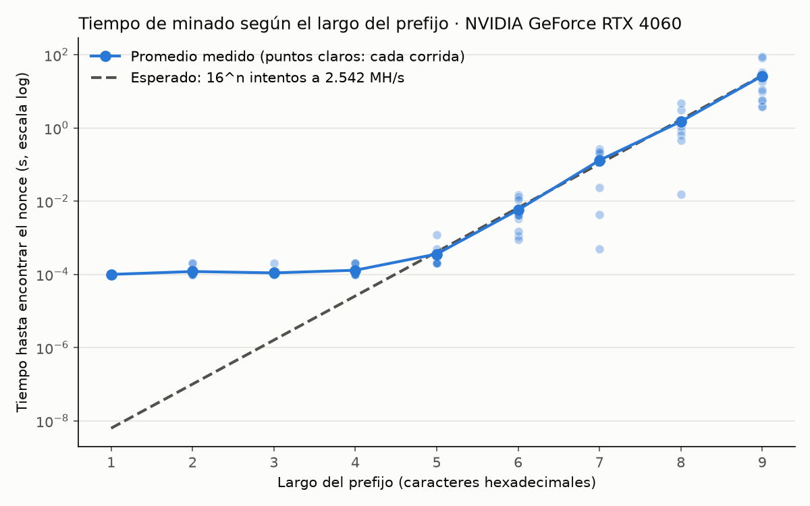

# Hit 6 — Largo del prefijo

Mide el minero del [Hit 5](../hit5/) con prefijos de ceros de largo 1 en adelante, 10 corridas por largo (cada una con otra cadena), y guarda cada corrida en `mediciones.csv`.

```bash
python3 medir.py --largos 1-9 --repeticiones 10   # compila el Hit 5 si hace falta; agrega al CSV
python3 graficar.py                               # tabla en Markdown + tiempo-vs-largo.png (necesita matplotlib)
```

## Resultados (RTX 4060, driver 615.78, CUDA 13.4)

Rendimiento sostenido: ~2.540 MH/s.

| Largo | Corridas | Intentos esperados (16^n) | Intentos promedio | Tiempo promedio | Mínimo | Máximo |
|---|---|---|---|---|---|---|
| 1 | 10 | 16 | 118 | 0.0001 s | 0.0001 s | 0.0001 s |
| 2 | 10 | 256 | 4.788 | 0.0001 s | 0.0001 s | 0.0002 s |
| 3 | 10 | 4.096 | 4.863 | 0.0001 s | 0.0001 s | 0.0002 s |
| 4 | 10 | 65.536 | 53.339 | 0.0001 s | 0.0001 s | 0.0002 s |
| 5 | 10 | 1.048.576 | 827.737 | 0.0004 s | 0.0002 s | 0.0012 s |
| 6 | 10 | 16.777.216 | 16.076.571 | 0.0058 s | 0.0009 s | 0.0150 s |
| 7 | 10 | 268.435.456 | 344.592.165 | 0.1309 s | 0.0005 s | 0.2609 s |
| 8 | 10 | 4.294.967.296 | 3.803.220.351 | 1.5023 s | 0.0152 s | 4.6817 s |
| 9 | 10 | 68.719.476.736 | 62.519.136.522 | 26.4053 s | 3.8709 s | 90.3186 s |



## Respuestas

- **¿Cuál fue el prefijo más largo?** 9 caracteres (`000000000`): 26 s en promedio, entre 4 y 90 s.
- **¿Qué relación hay entre el largo y el tiempo?** Exponencial: cada carácter hexadecimal más tiene 1 chance en 16 de coincidir, así que los intentos esperados son 16^n y el tiempo es ≈ 16^n / 2.540 MH/s. En escala logarítmica es una recta que sube ×16 por carácter, y desde el largo 6 lo medido la sigue.
- **Hasta el largo 5 el tiempo no crece:** una tanda prueba 2^20 ≈ 16^5 nonces, así que se resuelve en la primera, y lo que se mide es lanzar el kernel y copiar el resultado (~0,1 ms).
- **El tiempo varía mucho entre corridas** (en el largo 9, de 4 a 90 s): la cantidad de intentos hasta acertar es aleatoria, con una dispersión del orden de su promedio. Por eso hacen falta varias corridas por largo.
- **Con prefijos cortos los intentos promedio superan a 16^n:** el ganador es el primer hilo que llega al `atomicCAS`, no el de nonce más chico (ver el Hit 5). Desde el largo 5 casi nunca hay dos soluciones en la misma tanda y deja de notarse.
