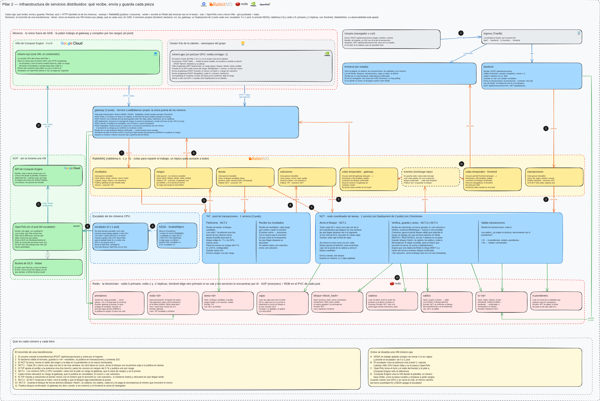

# Pilar 2 — Infraestructura distribuida

Una carpeta por servicio. Los de Python usan `comun/` y el mismo `Dockerfile`; `ejemplo/` muestra cómo.

Qué datos viajan entre los servicios (transacción, bloque, mensajes, API del gateway y claves de Redis): [CONTRATO.md](CONTRATO.md).

## Ejecutar (desde `pilar2/`)

```bash
pip install -r requirements-dev.txt
docker run -d --name rabbit -p 5672:5672 rabbitmq:4.1-alpine
docker run -d --name redis -p 6379:6379 redis:8.0-alpine
python -m ejemplo
curl localhost:8080/health      # {"ejemplo":"ok","rabbitmq":"ok","redis":"ok"}
curl -X POST localhost:8080/mensajes -H 'content-type: application/json' -d '{"texto":"hola"}'
```

- Tests: `python -m pytest`; con `INTEGRACION=1` también los que usan RabbitMQ y Redis.
- Imagen: `docker build --build-arg SERVICIO=ejemplo -t ejemplo .`
- Configuración por variables de entorno, con valores por defecto: ver `.env.example`.

## `comun/`

| Módulo | Qué hace |
|---|---|
| `servicio` | `Servicio(nombre, colas)` arma todo lo de abajo y atiende SIGTERM |
| `config` | Lee las variables de entorno |
| `registro` | Logs `fecha \| NIVEL \| mensaje` a stderr, a memoria (últimas 500) y a `logs/<servicio>.log` (1 MB × 3) |
| `web` | `/health` (503 si RabbitMQ o Redis no responden) y `/metrics` en el puerto 8080; cada servicio suma sus rutas |
| `rabbit` | Colas quorum durables, publicar con confirmación del broker, consumir con ack manual y reconexión sola; `avisar` y `suscribir` para los avisos de un exchange topic (cada suscriptor con su cola exclusiva) |
| `redisdb` | Redis directo o, con `REDIS_SENTINELS`, el primario que indique Sentinel |
| `contrato` | Validación de transacciones, el texto que se hashea, recompensa, génesis y nombres de colas y claves |

## Decisiones

- Si el manejador de un mensaje falla, el mensaje vuelve a la cola una vez; si falla de nuevo, se descarta y queda en el log. Si falla porque RabbitMQ o Redis no responden (p. ej. mientras Sentinel cambia el primario), vuelve a la cola siempre: así no se pierde.
- La conexión que consume es de su hilo: para publicar desde los endpoints HTTP se usa otra instancia de `Rabbit` (ver `ejemplo/app.py`).
- En Kubernetes, `/health` va como readiness probe: da 503 mientras falte una dependencia.

## Todo junto en k3s



Los números del diagrama son el recorrido de una transferencia (1 a 11); las letras, cómo se levanta una VM con un minero CPU.

```bash
kubectl create namespace blockchain
kubectl -n blockchain create secret generic blockchain-secretos --from-literal=RABBIT_USUARIO=blockchain \
  --from-literal=RABBIT_CLAVE="$(openssl rand -hex 16)" --from-literal=RABBIT_COOKIE="$(openssl rand -hex 32)" \
  --from-literal=REDIS_CLAVE="$(openssl rand -hex 16)" --from-literal=MINER_TOKEN="$(openssl rand -hex 24)"
k8s/imagenes.sh                      # construye las imágenes y las importa en k3s (containerd)
kubectl apply -k k8s                 # RabbitMQ, Redis, backend, frontend, nct, trp, gateway e Ingress
helm install monitoreo prometheus-community/kube-prometheus-stack --version 92.13.1 \
  -n monitoring --create-namespace -f k8s/monitoreo/valores-prometheus.yaml
helm install keda kedacore/keda --version 2.21.0 -n keda --create-namespace
kubectl apply -k k8s/monitoreo && kubectl apply -k k8s/escalador
```

- La página y la API, por el Ingress: `http://localhost` (`/api` → backend; `/` y `/eventos` → frontend).
- Los mineros, al gateway por su LoadBalancer: `GATEWAY_URL=http://localhost:8081` y el `MINER_TOKEN` del Secret. El CPU con `python -m minero_cpu`; el GPU con `python -m minero_gpu` o su imagen.
- 2 réplicas de cada servicio; el escalador, 0 o 1 pod según KEDA.

### Pruebas del sistema desplegado

`k8s/probar.sh` prueba RabbitMQ y Redis solos. `k8s/probar_sistema.sh` corre `sistema/` contra lo desplegado, como un cliente más (el Ingress y el gateway), con un minero CPU de prueba:

| Prueba | Qué tiene que pasar |
|---|---|
| Transferencia válida | Recibida → confirmada, en un bloque que extiende la cadena; el hash se verifica desde afuera, los saldos se mueven y el minero cobra |
| Sin saldo | Rechazada, con el motivo |
| Doble gasto simultáneo | Dos transferencias a la vez que gastan el mismo saldo: una confirmada y una rechazada |
| Cadena íntegra | Los últimos 100 bloques encadenan, cada hash se verifica y ninguna transacción está en dos |
| Minero muerto a mitad de un rango (`kill -9`) | A los 30 s el gateway devuelve el rango a la cola y otro minero resuelve el bloque |
| Matar una réplica del NCT, del TrP y del gateway | Una transferencia hecha enseguida se confirma igual, y el Deployment vuelve a 2 |
| Matar el primario de Redis | Sentinel promueve una réplica, lo ya confirmado sigue y lo nuevo se confirma |

Tras cada caída se vuelve a revisar la cadena. El 09/11, en k3s: las 9 pasan en unos 5 min (dos corridas seguidas). KEDA y el escalador se probaron aparte (ver [escalador/README.md](escalador/README.md)), igual que el minero GPU contra este gateway ([minero_gpu/README.md](minero_gpu/README.md)).

## Kubernetes (`k8s/`)

RabbitMQ y Redis, 3 pods cada uno, en el namespace `blockchain`. Sólo tienen Services internos (ClusterIP).

Los servicios usan `RABBIT_HOST=rabbitmq` y `REDIS_SENTINELS=redis:26379`, más las claves del Secret.

### RabbitMQ

- **Colas + tópico.** Una cola entrega cada mensaje a un solo consumidor: así se reparte el trabajo (un rango, un minero). El exchange topic `eventos` avisa a todos: cada pod del gateway y del frontend ata su propia cola a `bloque.confirmado`.
- **Quorum.** Cada cola tiene 3 réplicas (Raft). Si se cae el nodo líder, otra réplica toma su lugar sin perder los mensajes confirmados.
- Las colas y el exchange están en `rabbitmq/colas.json`. El usuario lo arma `rabbitmq/iniciar.sh` con el Secret, porque cuando hay definiciones RabbitMQ no crea el usuario por defecto.
- Las colas se crean cuando sólo está rabbitmq-0. La reconciliación de quorum las lleva a 3 réplicas cuando se suman los otros nodos.

### Redis

- redis-0 es el primario y redis-1/-2 son réplicas, con un Sentinel en cada pod. Si el primario no contesta durante 5 s, 2 de los 3 Sentinel eligen otro, y los servicios se pasan solos al nuevo (`comun/redisdb`).
- **Persistencia:** AOF cada segundo + RDB, en un volumen por pod. Ante una caída se pierde a lo sumo 1 s de escrituras.
- La copia a las réplicas es asíncrona: por eso el NCT hace `WAIT 1` antes de avisar un bloque.
- `redis/iniciar.sh` arma la configuración al arrancar: el primario es el que diga Sentinel, o redis-0 si ninguno contesta.
- Un pod que se cayó siendo primario **no vuelve como primario**: si Sentinel todavía lo nombra, espera (hasta 3 min) a que promueva a otro y arranca como réplica. Antes volvía como primario con datos viejos y durante ~10 s había dos primarios: lo que se escribía en el viejo se perdía (lo encontró la prueba de matar el primario).
- Las claves están en el [contrato](CONTRATO.md#claves-de-redis).

## TrP (`trp/`)

Toma cada tarea de `tareas`, elige el prefijo, la parte en rangos de nonce y publica uno por mensaje en `rangos` (NCT.2). Guarda `bloque`, `prefijo` y `rangos` en `tarea:<id>`, y recién después hace el ack de la tarea.

| Variable | Por defecto | Qué es |
|---|---|---|
| `ESPACIO_NONCES` | 2^32 | Se buscan nonces en [0, ESPACIO − 1] |
| `FRAGMENTO_PORCENTAJE` | 10 | Tamaño de cada rango en % del espacio (1 a 50): 1 % → 100 rangos, 50 % → 2 |
| `PREFIJO_BASE` | 6 | Caracteres del prefijo del sistema: el máximo |
| `SEGUNDOS_POR_BLOQUE` | 30 | Cuánto se quiere que tarde un bloque |
| `AJUSTAR_PREFIJO` | 1 | 0: siempre el prefijo base (para la prueba de prefijos) |
| `VIVO_SEGUNDOS` | 15 | Un minero cuenta si avisó hace menos que esto |

- **Prefijo:** con p caracteres hacen falta 16^p intentos en promedio. Con la potencia viva P (la suma de los `bench` de los mineros que avisaron hace menos de 15 s), el largo es el mayor p con 16^p ≤ P × 30 s, entre 1 y `PREFIJO_BASE`. Sin GPU baja (un minero CPU de 8,6 MH/s da 6; uno de 0,5 MH/s, 5); sin mineros vivos es 1, para que el primero que llegue lo resuelva enseguida.
- Si el pod muere a mitad, la tarea vuelve a la cola y se repite entera: `tarea:<id>` queda igual y los rangos repetidos no molestan.

También toma `resultados` (otra conexión, en otro hilo) y le pasa al NCT, por `soluciones`, sólo el ganador:

- Gana el primer nonce **verificado** de cada tarea (el TrP recalcula el hash con el texto y el prefijo de `tarea:<id>`); los que llegan después se descartan.
- `ganador` en `tarea:<id>` se escribe una sola vez con `HSETNX`: con 2 pods sale una sola solución. Si el pod muere antes del ack, el mensaje vuelve y se publica de nuevo la misma solución.
- Los rangos sin solución se anotan en el conjunto `tarea:<id>:sin_solucion` (un rango repetido no cuenta dos veces). Cuando están todos, publica `{tarea, sin_solucion: true}` para que el NCT rearme el bloque.

## Minero CPU (`minero_cpu/`)

Corre fuera del cluster y sólo habla con el gateway por HTTP (API en el [contrato](CONTRATO.md#api-del-gateway)).

```bash
docker build --build-arg SERVICIO=minero_cpu -t minero-cpu .
docker run -e GATEWAY_URL=http://<gateway>:8080 -e MINER_TOKEN=... minero-cpu
```

| Variable | Por defecto | Qué es |
|---|---|---|
| `GATEWAY_URL` | `http://localhost:8080` | Dónde está el gateway |
| `MINER_TOKEN` | — (obligatoria) | Token de los mineros |
| `MINERO_ID` | el hostname | Su id; cobra la recompensa en `saldos` |
| `PROCESOS` | un proceso por núcleo | Procesos que recorren el rango (por el GIL, no hilos) |
| `KEEPALIVE_SEGUNDOS` | 5 | Cada cuánto avisa que está vivo |

- Devuelve el **menor** nonce del rango, como el minero GPU del Hit 7: los procesos toman trozos de 2^16 en orden.
- Si el keep-alive contesta `cortar`, deja el rango sin mandar resultado. Si el gateway no contesta, reintenta con espera creciente.
- En un Ryzen 5 3600: 1,7 MH/s por núcleo y 8,6 MH/s con 12 procesos (la tarea modelo, en ~2 s).

## Escalador (`escalador/`)

Levanta y borra VMs con mineros CPU cuando no hay GPU; KEDA lo prende y lo apaga (0 o 1 pod). Ver [escalador/README.md](escalador/README.md).

## Minero GPU (`minero_gpu/`)

El minero CUDA con el mismo cliente HTTP que el minero CPU. Ver [minero_gpu/README.md](minero_gpu/README.md).
