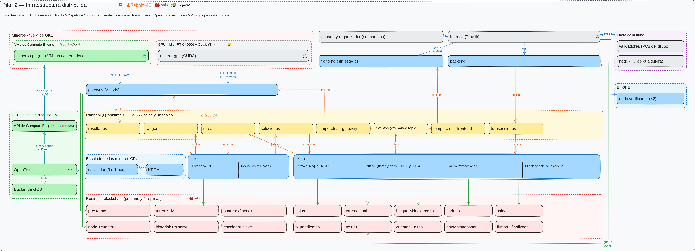

# Pilar 2 — Infraestructura distribuida

Una carpeta por servicio. Los de Python usan `comun/` y el mismo `Dockerfile`; `ejemplo/` muestra cómo.

Qué datos viajan entre los servicios (transacción, bloque, mensajes, API del gateway y claves de Redis): [CONTRATO.md](CONTRATO.md).

## Ejecutar (desde `pilar2/`)

```bash
pip install -r requirements-dev.txt
docker run -d --name rabbit -p 5672:5672 rabbitmq:4.1-alpine
docker run -d --name redis -p 6379:6379 redis:8.0-alpine
python -m ejemplo
curl localhost:8080/health      # {"ejemplo":"ok","rabbitmq":"ok","redis":"ok"}
curl -X POST localhost:8080/mensajes -H 'content-type: application/json' -d '{"texto":"hola"}'
```

- Tests: `python -m pytest`; con `INTEGRACION=1` también los que usan RabbitMQ y Redis.
- Imagen: `docker build --build-arg SERVICIO=ejemplo -t ejemplo .`
- Configuración por variables de entorno, con valores por defecto: ver `.env.example`.

## `comun/`

| Módulo | Qué hace |
|---|---|
| `servicio` | `Servicio(nombre, colas)` arma todo lo de abajo y atiende SIGTERM |
| `config` | Lee las variables de entorno |
| `registro` | Logs `fecha \| NIVEL \| mensaje` a stderr, a memoria (últimas 500) y a `logs/<servicio>.log` (1 MB × 3); cada ERROR suma a `blockchain_errores_total{servicio, tipo}` (`tipo`: la clase de la excepción, o `log`) |
| `web` | `/health` (503 si RabbitMQ o Redis no responden) y `/metrics` en el puerto 8080; cada servicio suma sus rutas |
| `rabbit` | Colas quorum durables, publicar con confirmación del broker, consumir con ack manual y reconexión sola; `avisar` y `suscribir` para los avisos de un exchange topic (cada suscriptor con su cola exclusiva) |
| `redisdb` | Redis directo o, con `REDIS_SENTINELS`, el primario que indique Sentinel |
| `contrato` | Cuentas y firmas Ed25519, transacciones firmadas, emisión, el texto de cada minero, shares, épocas, génesis y nombres de colas y claves ([CONTRATO.md](CONTRATO.md)) |

## Decisiones

- Si el manejador de un mensaje falla, el mensaje vuelve a la cola una vez; si falla de nuevo, se descarta y queda en el log. Si falla porque RabbitMQ o Redis no responden (p. ej. mientras Sentinel cambia el primario), vuelve a la cola siempre: así no se pierde.
- La conexión que consume es de su hilo: para publicar desde los endpoints HTTP se usa otra instancia de `Rabbit` (ver `ejemplo/app.py`).
- En Kubernetes, `/health` va como readiness probe: da 503 mientras falte una dependencia.

## Todo junto en k3s



```bash
kubectl create namespace blockchain
kubectl -n blockchain create secret generic blockchain-secretos --from-literal=RABBIT_USUARIO=blockchain \
  --from-literal=RABBIT_CLAVE="$(openssl rand -hex 16)" --from-literal=RABBIT_COOKIE="$(openssl rand -hex 32)" \
  --from-literal=REDIS_CLAVE="$(openssl rand -hex 16)"
k8s/imagenes.sh                      # construye las imágenes y las importa en k3s (containerd)
kubectl apply -k k8s                 # RabbitMQ, Redis, backend, frontend, nct, trp, gateway e Ingress
# Monitoreo (ver «Observabilidad»): la contraseña de Grafana va en un Secret, nunca en el repo
kubectl create namespace monitoring
kubectl -n monitoring create secret generic grafana-admin --from-literal=admin-user=admin \
  --from-literal=admin-password="$(openssl rand -hex 16)"
helm repo add prometheus-community https://prometheus-community.github.io/helm-charts
helm repo add grafana https://grafana.github.io/helm-charts
helm repo add fluent https://fluent.github.io/helm-charts
helm repo add kedacore https://kedacore.github.io/charts
helm install monitoreo prometheus-community/kube-prometheus-stack --version 92.13.1 \
  -n monitoring -f k8s/monitoreo/valores-prometheus.yaml
helm install loki grafana/loki --version 7.6.0 -n monitoring -f k8s/monitoreo/valores-loki.yaml
helm install fluent-bit fluent/fluent-bit --version 0.58.3 -n monitoring -f k8s/monitoreo/valores-fluent-bit.yaml
helm install keda kedacore/keda --version 2.21.0 -n keda --create-namespace
kubectl apply -k k8s/monitoreo && kubectl apply -k k8s/escalador
```

- La página y la API, por el Ingress: `http://localhost` (`/api` → backend; `/` y `/eventos` → frontend). Las altas se piden en `/alta` y el organizador las aprueba en el modo organizador de la [billetera](billetera/) o con `python -m claves`, con su clave (en k3s, la de prueba `organizador` de `comun/tests/claves.py`).
- Los mineros, al gateway por su LoadBalancer: `GATEWAY_URL=http://localhost:8081` y su clave (la generan la primera vez y muestran su cuenta). El minero queda pedido solo y el organizador lo aprueba desde la billetera (o `k8s/aprobar.sh <cuenta> minero <alias>`). El CPU con `python -m minero_cpu`; el GPU con `python -m minero_gpu` o su imagen.
- Las cuentas del génesis son las de prueba alice, bob y carol (`comun/tests/claves.py`: sus privadas se derivan del nombre, sirven para probar). La ráfaga de la demo: `../pilar3/pruebas/rafaga.sh http://localhost 20`.
- 2 réplicas de cada servicio; el escalador, 0 o 1 pod según KEDA.

### Pruebas del sistema desplegado

`k8s/probar.sh` prueba RabbitMQ y Redis solos. `k8s/probar_sistema.sh` corre `sistema/` contra lo desplegado, como un cliente más (el Ingress y el gateway), con un minero CPU de prueba. Las cuentas y los mineros de prueba los aprueba con `k8s/aprobar.sh` (kubectl exec en el Redis):

| Prueba | Qué tiene que pasar |
|---|---|
| Transferencia válida | Recibida → confirmada, en un bloque que extiende la cadena; el hash se verifica desde afuera, los saldos se mueven y el minero cobra |
| Sin saldo | Rechazada, con el motivo |
| Cuenta sin aprobar | Rechazada: `cuenta no aprobada` |
| Firma falsa o monto cambiado | 400 en el backend: nadie manda una transferencia de bob sin la clave de bob |
| Reenvío | La misma transacción otra vez: 409, y se confirma una sola |
| Doble gasto con el mismo nonce | Dos transacciones distintas firmadas con el mismo nonce, a la vez: una confirmada y otra `nonce repetido` |
| Cadena íntegra | Los últimos 100 bloques encadenan, cada hash se verifica y ninguna transacción está en dos |
| Minero muerto a mitad de un rango (`kill -9`) | A los 30 s el gateway devuelve el rango a la cola y otro minero resuelve el bloque |
| Matar una réplica del NCT, del TrP y del gateway | Una transferencia hecha enseguida se confirma igual, y el Deployment vuelve a 2 |
| Matar el primario de Redis | Sentinel promueve una réplica, lo ya confirmado sigue y lo nuevo se confirma |

Tras cada caída se vuelve a revisar la cadena. El 09/11, en k3s: las 9 pasan en unos 5 min (dos corridas seguidas). KEDA y el escalador se probaron aparte (ver [escalador/README.md](escalador/README.md)), igual que el minero GPU contra este gateway ([minero_gpu/README.md](minero_gpu/README.md)).

### Observabilidad (`k8s/monitoreo/`)

Todo en el namespace `monitoring`, instalado con Helm desde los valores de `k8s/monitoreo/` (versiones fijas, las mismas en k3s y en GKE):

| Pieza | Qué hace |
|---|---|
| kube-prometheus-stack (`monitoreo`) | Prometheus (3 días de métricas), Alertmanager sin receivers, Grafana, kube-state-metrics y node-exporter. KEDA consulta `monitoreo-prometheus.monitoring.svc:9090`: no cambiar el nombre del release |
| Loki (`loki`) | Un solo pod, 2 Gi en disco, 3 días de logs; límite de 512 Mi de memoria |
| Fluent Bit (`fluent-bit`) | Un pod por nodo, también en los que tienen taints. Lee los contenedores de `blockchain`, saca el `nivel` de «fecha \| NIVEL \| mensaje» y manda a Loki con las labels `namespace`, `app` y `nivel` (el pod va como metadato) |

`kubectl apply -k k8s/monitoreo` suma lo nuestro: los PodMonitor, las alertas (`alertas.yaml`) y el dashboard (`dashboard.json`, que el sidecar de Grafana carga desde un ConfigMap).

```bash
kubectl -n monitoring port-forward svc/monitoreo-grafana 3000:80    # http://localhost:3000
kubectl -n monitoring get secret grafana-admin -o jsonpath='{.data.admin-password}' | base64 -d
```

- **Dashboard «Blockchain distribuida»:** transacciones, bloques, mineros y prefijo, reparto del trabajo (con los rangos por minero y por tipo), historial de mineros (BC-54: una tabla por minero con alta, horas conectado, bloques, recompensas, shares y hashrate; sus curvas; y las altas, conexiones y desconexiones desde Loki), colas, VMs del escalador, CPU y memoria por servicio (suma de las réplicas: un pod reemplazado no deja una serie suelta), errores y logs separados por tema (errores, advertencias, bloques y épocas, escalado y dificultad; el log completo, en una fila plegada). `$app` filtra por servicio, `$nivel` el log completo y `$mineros` muestra sólo los mineros vivos (por defecto) o también los que se fueron. Grafana no tiene disco: el dashboard y los datasources (`prometheus` y `loki`) vuelven a cargarse en cada arranque.
- **Errores:** cada log ERROR o superior de un servicio suma a `blockchain_errores_total{servicio, tipo}` (lo hace `comun/registro`).
- **Logs:** también los de un pod que ya no existe. En Grafana → Explore → Loki, p. ej. `{app="nct", nivel="ERROR"}`. Los de los mineros no entran (corren fuera del cluster).

| Alerta | Se dispara cuando |
|---|---|
| SinMinerosGPU | No hay ningún minero GPU vivo durante 1 min. En una máquina sin GPU está disparada desde el arranque |
| ColaRangosAcumulada | Hay más de 50 rangos en la cola `rangos` durante 2 min (umbral provisorio, a ajustar con BC-38 a BC-41) |
| SinBloquesNuevos | Hay transacciones pendientes o en cajas y no salió ningún bloque en 10 min |
| ServicioCaido | Un target del sistema no responde, o un Deployment o StatefulSet de `blockchain` (salvo el escalador, que se apaga solo) queda sin réplicas, durante 30 s |

Se ven en Grafana (Alerting) o en Alertmanager (`port-forward svc/monitoreo-alertmanager 9093`).

`k8s/probar_sistema.sh` también prueba el monitoreo: abre port-forwards a Prometheus, Loki y Grafana (o usa `PROMETHEUS_URL`, `LOKI_URL` y `GRAFANA_URL` si vienen) y saca la contraseña del Secret. Sólo eso: `k8s/probar_sistema.sh -k monitoreo` (unos 2 min).

| Prueba | Qué tiene que pasar |
|---|---|
| Targets | Los de los PodMonitor `blockchain-apps` y `rabbitmq`, todos `up` |
| Alertas | Las 4 de `blockchain-alertas` cargadas en Prometheus |
| SinMinerosGPU | Disparada sin mineros GPU. Un minero falso `tipo="gpu"` (el cliente del minero CPU, sólo con keep-alives) la resuelve; al cortarlo, vuelve a dispararse |
| Logs | Loki tiene líneas de backend, frontend, NCT, TrP y gateway; el filtro por `nivel` trae sólo ese nivel; los logs de un pod del TrP borrado siguen ahí |
| Grafana | Los datasources `prometheus` y `loki` responden y el dashboard aparece en la búsqueda |

## Kubernetes (`k8s/`)

RabbitMQ y Redis, 3 pods cada uno, en el namespace `blockchain`. Sólo tienen Services internos (ClusterIP).

Los servicios usan `RABBIT_HOST=rabbitmq` y `REDIS_SENTINELS=redis:26379`, más las claves del Secret.

### RabbitMQ

- **Colas + tópico.** Una cola entrega cada mensaje a un solo consumidor: así se reparte el trabajo (un rango, un minero). El exchange topic `eventos` avisa a todos: cada pod del gateway y del frontend ata su propia cola a `bloque.confirmado`.
- **Quorum.** Cada cola tiene 3 réplicas (Raft). Si se cae el nodo líder, otra réplica toma su lugar sin perder los mensajes confirmados.
- Las colas y el exchange están en `rabbitmq/colas.json`. El usuario lo arma `rabbitmq/iniciar.sh` con el Secret, porque cuando hay definiciones RabbitMQ no crea el usuario por defecto.
- Las colas se crean cuando sólo está rabbitmq-0. La reconciliación de quorum las lleva a 3 réplicas cuando se suman los otros nodos.

### Redis

- redis-0 es el primario y redis-1/-2 son réplicas, con un Sentinel en cada pod. Si el primario no contesta durante 5 s, 2 de los 3 Sentinel eligen otro, y los servicios se pasan solos al nuevo (`comun/redisdb`).
- **Persistencia:** AOF cada segundo + RDB, en un volumen por pod. Ante una caída se pierde a lo sumo 1 s de escrituras.
- La copia a las réplicas es asíncrona: por eso el NCT hace `WAIT 1` antes de avisar un bloque.
- `redis/iniciar.sh` arma la configuración al arrancar: el primario es el que diga Sentinel, o redis-0 si ninguno contesta.
- Un pod que se cayó siendo primario **no vuelve como primario**: si Sentinel todavía lo nombra, espera (hasta 3 min) a que promueva a otro y arranca como réplica. Antes volvía como primario con datos viejos y durante ~10 s había dos primarios: lo que se escribía en el viejo se perdía (lo encontró la prueba de matar el primario).
- Las claves están en el [contrato](CONTRATO.md#claves-de-redis).

## TrP (`trp/`)

Toma cada tarea de `tareas`, elige el prefijo, la parte en rangos de nonce y publica uno por mensaje en `rangos` (NCT.2). Guarda `prefijo` y `rangos` en `tarea:<id>`, y recién después hace el ack de la tarea. Los rangos no llevan texto: el de cada minero, con su coinbase, lo arma el gateway al prestarlo (BC-62).

| Variable | Por defecto | Qué es |
|---|---|---|
| `ESPACIO_NONCES` | 2^32 | Se buscan nonces en [0, ESPACIO − 1] |
| `FRAGMENTO_PORCENTAJE` | 10 | Tamaño de cada rango en % del espacio (1 a 50): 1 % → 100 rangos, 50 % → 2 |
| `PREFIJO_BASE` | 6 | Caracteres del prefijo del sistema: el máximo |
| `SEGUNDOS_POR_BLOQUE` | 60 | Tiempo esperado por bloque (1 minuto, BC-60) |
| `VENTANA_AJUSTE` | 5 | Cada cuántos bloques minados se reajusta el prefijo por tiempo |
| `AJUSTE_MAXIMO` | 1 | Máximo de caracteres que cambia por ajuste (`±1` equivale a `×4` / `÷4`) |
| `PREFIJO_INICIAL` | 0 | 0: arranca según potencia viva; > 0: arranca en ese largo (pruebas de convergencia) |
| `AJUSTAR_PREFIJO` | 1 | 0: siempre el prefijo base (para la prueba de prefijos) |
| `VIVO_SEGUNDOS` | 15 | Un minero cuenta si avisó hace menos que esto |
| `CRITERIO_POTENCIA` | suma | Cómo se junta el `bench` de los vivos para el prefijo (`suma`, `promedio`, `minimo` o `maximo`). Fuera de la suma, sólo para la prueba de BC-59 |

- **Prefijo (BC-21, BC-59 y BC-60):** `largo_prefijo` calcula el techo según la potencia viva P, la **suma** de los `bench` de los mineros que avisaron hace menos de 15 s (`16^p ≤ P × 60 s`, entre 1 y `PREFIJO_BASE`; sin mineros vivos, 1). Cada `VENTANA_AJUSTE` (5) bloques minados, `ajustar_por_tiempo` toma el promedio `real` de los últimos 5 bloques desde Redis (`cadena` y `bloque:<hash>`) y ajusta el largo con `redondeo(log16(esperado / real))` acotado a `±AJUSTE_MAXIMO` (`±1`, umbral ×4 como Bitcoin Core). El resultado final es `min(por_tiempo, techo)`, de modo que si se cae la GPU la dificultad baja de inmediato sin esperar 5 bloques lentos. Por qué la suma y no el promedio, el mínimo o el máximo, por qué el `bench` y cómo se reparte el trabajo según la potencia: [trp/README.md](trp/README.md).
- Si el pod muere a mitad, la tarea vuelve a la cola y se repite entera: `tarea:<id>` queda igual y los rangos repetidos no molestan.

También toma `resultados` (otra conexión, en otro hilo) y le pasa al NCT, por `soluciones`, sólo el ganador:

- Gana el primer nonce **verificado** de cada tarea (el TrP recalcula el hash con el texto de ese minero, `texto_para`, y el prefijo de `tarea:<id>`); los que llegan después se descartan.
- `ganador` en `tarea:<id>` se escribe una sola vez con `HSETNX`: con 2 pods sale una sola solución. Si el pod muere antes del ack, el mensaje vuelve y se publica de nuevo la misma solución.
- Los rangos sin solución se anotan en el conjunto `tarea:<id>:sin_solucion` (un rango repetido no cuenta dos veces). Cuando están todos, publica `{tarea, sin_solucion: true}` para que el NCT rearme el bloque.

## Minero CPU (`minero_cpu/`)

Corre fuera del cluster y sólo habla con el gateway por HTTP (API en el [contrato](CONTRATO.md#api-del-gateway)).

```bash
docker build --build-arg SERVICIO=minero_cpu -t minero-cpu .
docker run -e GATEWAY_URL=http://<gateway>:8080 -e CLAVE_PRIVADA=<64 hex> -e MINERO_ID=cpu-1 minero-cpu
```

| Variable | Por defecto | Qué es |
|---|---|---|
| `GATEWAY_URL` | `http://localhost:8080` | Dónde está el gateway |
| `MINERO_ID` | el hostname | Su alias (para los logs y el nombre al aprobarlo); cobra en su cuenta |
| `CLAVE_PRIVADA` | — | Su clave Ed25519 en hex (así se la pasa el escalador a las VMs) |
| `CLAVE_SEMILLA` | — | Si no hay `CLAVE_PRIVADA`: la clave sale de sha256("<semilla>:<alias>") (las réplicas del minero GPU en k8s) |
| `CLAVE_ARCHIVO` | `minero.clave` | Si no hay ninguna de las dos: la lee, o la genera la primera vez (permisos 600) |
| `PROCESOS` | un proceso por núcleo | Procesos que recorren el rango (por el GIL, no hilos) |
| `KEEPALIVE_SEGUNDOS` | 5 | Cada cuánto avisa que está vivo |

- Devuelve el **menor** nonce del rango, como el minero GPU del Hit 7: los procesos toman trozos de 2^16 en orden.
- Cada pedido va firmado con su clave (BC-57). Si su cuenta todavía no está aprobada (403), avisa y reintenta cada 30 s; si el gateway rechaza la firma (401, por ejemplo el reloj corrido), termina.
- Junta los shares (BC-63) y los manda en cada keep-alive y en el resultado.
- Si el keep-alive contesta `cortar`, deja el rango sin mandar resultado. Si el gateway no contesta, reintenta con espera creciente.
- En un Ryzen 5 3600: 1,7 MH/s por núcleo y 8,6 MH/s con 12 procesos (la tarea modelo, en ~2 s).

## Claves y auditoría (`claves/` y `herramientas/`)

- `python -m claves`: generar, ver la pública, exportar a JWK (para el navegador), firmar y mandar una transferencia, una carga del organizador, aprobar una cuenta y la ráfaga. Ver [claves/README.md](claves/README.md).
- `python -m herramientas.auditar`: recorre la cadena desde el génesis, verifica todo y compara los saldos con Redis. Ver [herramientas/README.md](herramientas/README.md).

## Escalador (`escalador/`)

Levanta y borra VMs con mineros CPU cuando no hay GPU; KEDA lo prende y lo apaga (0 o 1 pod). Ver [escalador/README.md](escalador/README.md).

## Minero GPU (`minero_gpu/`)

El minero CUDA con el mismo cliente HTTP que el minero CPU. Ver [minero_gpu/README.md](minero_gpu/README.md).
