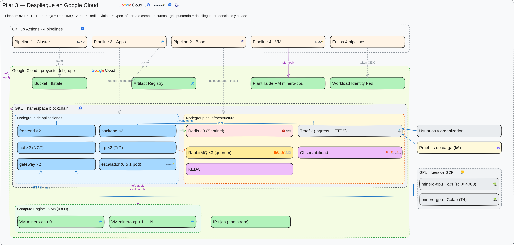

# Pilar 3 — Despliegue, pruebas y escalabilidad

> **Desplegado** en el proyecto `chimera-blockchain` (org `distribuidos-chimera`). Sistema en `https://blockchain-chimera.chimera-sdypp.workers.dev` (el Worker de [cloudflare/](cloudflare/), que reenvía a `https://blockchain-chimera.duckdns.org`)
> y estado de cada servicio en `/salud/<servicio>`; los mineros entran por `http://<IP del gateway>:8081`.
> Sin las variables `GCP_*` en el repo los pipelines sólo validan (`fmt` y `validate`).



| Carpeta | Qué es | Pipeline |
|---|---|---|
| `bootstrap/` | Base de GCP: APIs, Artifact Registry, Secret Manager, Workload Identity Federation (BC-31), las IP fijas del gateway y de Traefik (`ingreso`) y las cuentas de servicio con sus permisos ([Permisos](#permisos)) | A mano, con Owner |
| `infra/` | VPC y GKE zonal con dos nodegroups, `infra` (con taint) y `apps` (BC-32) | 1 · `pilar3-cluster.yml` |
| `helm/`, `k8s/servicios-base/` | Traefik, cert-manager, KEDA, RabbitMQ ×3, Redis ×3 y la observabilidad en el nodegroup de infra (BC-33, BC-37) | 2 · `pilar3-servicios-base.yml` |
| `k8s/apps/` | frontend, backend, nct, trp, gateway y escalador en el nodegroup de apps, y `/salud/<servicio>` (BC-34) | 3 · `pilar3-apps.yml` |
| `vms/` | Plantilla de las VMs minero-cpu, firewall y permisos (BC-35) | 4 · `pilar3-vms.yml` |
| `vms/instancias/` | Las VMs `minero-cpu-0…N-1` (BC-35) | Ninguno: lo aplica el escalador |
| [`pruebas/`](pruebas/README.md) | Pruebas de carga (BC-38 a BC-42) y cómo dejar GKE en sus condiciones | A mano: `pilar3-preparar-prueba.yml` |
| [`PRODUCCION.md`](PRODUCCION.md) | Checklist productivo (autoscaling, HPA, RBAC, NetworkPolicies, `securityContext`, NTP, BC-100) | — |

Cada módulo tiene `provider.tf`, `variables.tf`, `main.tf` y `outputs.tf`. El state va a un bucket de GCS (`<proyecto>-tfstate`), con lock y con versionado. Nunca va al repo.

## Base de GCP (una vez, a mano)

El pipeline necesita el bucket y WIF para entrar a GCP, así que estos dos se crean desde una PC con `gcloud auth application-default login`. No se usan claves de cuenta de servicio.

```bash
PROYECTO=<id-del-proyecto>
gcloud storage buckets create gs://$PROYECTO-tfstate --project $PROYECTO --location us-central1 \
  --uniform-bucket-level-access
gcloud storage buckets update gs://$PROYECTO-tfstate --versioning

cd pilar3/bootstrap
tofu init -backend-config="bucket=$PROYECTO-tfstate"
tofu apply -var proyecto=$PROYECTO

# Las salidas se cargan como variables del repo (no son secretos)
for v in GCP_PROYECTO GCP_WIF_PROVEEDOR GCP_CUENTA_CI GCP_REGISTRO GATEWAY_URL; do
  gh variable set $v --body "$(tofu output -raw $v)"
done
```

El proveedor OIDC sólo acepta tokens de `chimera-sdypp/BlockChain-Distribuida`. El pipeline recibe un token de GCP que vence en 1 h.

## Permisos

Las cuentas de servicio y sus roles en el proyecto viven en `bootstrap/`, que aplica a mano quien tiene Owner. Los pipelines no pueden crear cuentas ni darse roles (BC-109).

| Cuenta | Qué puede hacer | Sobre qué | Por qué |
|---|---|---|---|
| `escalador` | Crear, leer y borrar instancias y discos; leer y usar la plantilla; usar la subred; leer los guest attributes (rol custom `escaladorVms`) | Sólo lo que se llama `minero-cpu-*` y la subred `blockchain-nodos` (condición IAM por nombre) | Levantar y bajar sus VMs y leer la clave pública de cada una (BC-95) |
| `escalador` | Listar instancias y plantillas y seguir las operaciones de zona (rol custom `escaladorListar`) | El proyecto, sin condición | Las listas no se pueden acotar por nombre; listar no deja tocar nada |
| `escalador` | `objectAdmin` | Sólo `vms-instancias/` en el bucket de states, más listar el bucket | Su state; no puede leer ni pisar el de `infra`, `vms` ni `bootstrap` |
| `escalador` | `serviceAccountUser` | Sólo la cuenta `minero-cpu` | Ponérsela a las VMs que crea |
| `minero-cpu` | `artifactregistry.reader`, `logging.logWriter` | El proyecto | Bajar la imagen y escribir logs |
| `ci-github` | `serviceAccountAdmin` | Sólo la cuenta `escalador` | `infra/` le pone el binding de Workload Identity |

### Comprobar los permisos del escalador

La imagen del escalador no trae `gcloud`: se usa un pod temporal con su mismo ServiceAccount, que por Workload Identity entra como la cuenta `escalador`:

```bash
kubectl -n blockchain run prueba-escalador --rm -it --restart=Never --image=google/cloud-sdk:slim \
  --overrides='{"spec":{"serviceAccountName":"escalador","nodeSelector":{"nodegroup":"apps"}}}' -- bash

# adentro:
PROYECTO=$(curl -s -H 'Metadata-Flavor: Google' http://metadata.google.internal/computeMetadata/v1/project/project-id)
gcloud auth list                                                         # escalador@…
NODO=$(gcloud compute instances list --filter='name~^gke-' --format='value(name)' --limit=1)
gcloud compute instances delete "$NODO" --zone us-central1-a --quiet    # 403
gcloud storage cat gs://$PROYECTO-tfstate/infra/default.tfstate          # 403
echo x | gcloud storage cp - gs://$PROYECTO-tfstate/infra/prueba         # 403
gcloud storage ls gs://$PROYECTO-tfstate/vms-instancias/                 # anda
```

Y el escalado tiene que seguir andando: con carga sube a N VMs y en reposo vuelve a 0.

### Migración de BC-111 (una vez)

Las cuentas `escalador` y `minero-cpu` existían en los states de `infra` y `vms`. El orden evita que el escalador quede sin permisos en el medio:

1. **Owner, desde `pilar3/bootstrap/`:** `tofu plan -var proyecto=$PROYECTO` tiene que mostrar 5 imports (las dos cuentas, los dos roles de `minero-cpu` y el `serviceAccountUser`) y sólo creaciones: los dos roles custom, sus bindings, el binding con condición sobre el bucket y el `serviceAccountAdmin` de `ci-github` sobre `escalador`. Nada se destruye. Después, `tofu apply`. Desde acá el escalador tiene los permisos viejos y los nuevos.
2. **Merge a `main`:** el Pipeline 1 y el 4 olvidan las cuentas (`removed`, sin borrarlas) y el 4 borra los permisos amplios (`instanceAdmin.v1` en el proyecto y `objectAdmin` en todo el bucket).
3. **Borrar `bootstrap/migracion.tf`** en un PR aparte: en un proyecto nuevo los imports fallarían. El plan de `bootstrap` tiene que dar «sin cambios».
4. Las pruebas de arriba.

## Pipeline 1 · Cluster

- **En un PR:** gitleaks, `tofu fmt`, `validate` y `plan`. El plan queda comentado en el PR.
- **Al mergear a `main`:** `apply`.
- **Nodegroups:** `infra` tiene 1 nodo y taint `nodegroup=infra:NoSchedule`; `apps`, 1 nodo (los requests de cada uno suman ~0,5 vCPU). Las máquinas son `e2-standard-2` **spot** con disco estándar de 30 GB: si GCP se lleva un nodo, GKE crea otro y los pods vuelven.
- **Cuentas de servicio:**
  - La de los nodos (`gke-nodos`) baja las imágenes de Artifact Registry, así que no hacen falta pull secrets.
  - La del escalador entra a GCP desde el ServiceAccount `blockchain/escalador` por Workload Identity. La cuenta y sus permisos los crea `bootstrap/` (ver [Permisos](#permisos)); acá sólo va el binding de Workload Identity, que necesita el pool del cluster.
- **Costo estimado:** ≈ USD 0,10/h (≈ USD 2,5/día): 2 nodos spot, los 2 LoadBalancer (Traefik y gateway, lo que más pesa) y los discos. El cluster zonal no paga la administración. **Cobra desde que existe:** al terminar, `tofu destroy`.

Para conectarse: `tofu output -raw conectarse`.

## Pipeline 2 · Servicios base

- **En un PR:** gitleaks, `helm template` de todos los charts y `kubectl kustomize` de RabbitMQ, Redis y el monitoreo.
- **Al mergear a `main`** (o a mano, con *Run workflow*): los instala en GKE y espera a que estén listos.
- **Traefik** (chart 42.3.2) es la clase de Ingress por defecto, con 2 réplicas. Su LoadBalancer toma la IP fija `ingreso` (puertos 80 y 443), a la que apunta `blockchain-chimera.duckdns.org`. El balanceador HTTP de GKE está desactivado en `infra/`.
- **HTTPS:** cert-manager (chart v1.21.3) pide el certificado a Let's Encrypt por HTTP-01 (`k8s/certificados/`) y HTTP redirige a HTTPS (`k8s/apps/ingreso-https.yaml`). Hace falta porque el navegador sólo habilita WebCrypto (con lo que las páginas firman) en HTTPS o en `localhost`.
- **KEDA** usa el chart 2.21.0, el mismo que en k3s.
- **RabbitMQ y Redis** usan los manifiestos del Pilar 2 sin cambios: [`servicios-base/`](k8s/servicios-base/kustomization.yaml) sólo les agrega el nodeSelector y la toleration de infra. Sus Services son internos.
- **El Secret `blockchain-secretos`** sale de los secretos del ambiente `produccion` de GitHub: `RABBIT_USUARIO`, `RABBIT_CLAVE`, `RABBIT_COOKIE` y `REDIS_CLAVE`. Los mineros no usan un secreto compartido: firman con su clave (BC-57).
- **El Secret `escalador-clave`** (BC-95) sale del secreto `ESCALADOR_CLAVE` del mismo ambiente: la privada con que el escalador firma las altas delegadas de sus VMs. Sin él, el Pipeline 2 falla y el escalador no arranca (hasta la v3 la generaba y la guardaba en Redis). Cada VM genera su propia clave al arrancar y publica sólo la pública en sus guest attributes: ninguna privada pasa por Redis ni por el state de `vms/instancias`. Al rotar la del escalador, el organizador le da un `permiso-` a la clave nueva.
- **Cuentas en GKE** ([`k8s/apps/nct-saldos.yaml`](k8s/apps/nct-saldos.yaml)): el génesis va vacío (BC-91) y la plata entra sólo por cargas del organizador, cuya privada no está en el repo (`ORGANIZADOR_CLAVE` es su pública). Las pruebas de carga firman con cuentas propias ([`pruebas/cuentas.py`](pruebas/cuentas.py)). El CI frena un manifiesto de `pilar3/` con saldos en el génesis o una cuenta de `comun/tests/claves.py` ([`k8s/sin_cuentas_de_prueba.py`](k8s/sin_cuentas_de_prueba.py)).
- **Observabilidad (BC-37):** los mismos charts y values que en k3s ([pilar2](../pilar2/README.md)), más [`monitoreo.yaml`](helm/monitoreo.yaml) y [`loki.yaml`](helm/loki.yaml), que los mandan al nodegroup de infra. La contraseña de Grafana sale del secreto `GRAFANA_CLAVE` del ambiente. Se entra por port-forward: `kubectl -n monitoring port-forward svc/monitoreo-grafana 3000:80`.

## Pipeline 3 · Apps

- **En un PR:** gitleaks y, por cada app que cambió, sus tests con RabbitMQ y Redis reales, y el build de la imagen. Además se valida `k8s/apps/`.
- **Al mergear a `main`:**
  - push a Artifact Registry (tag = sha) de las apps que cambiaron;
  - un solo apply de [`k8s/apps/`](k8s/apps/kustomization.yaml): las que cambiaron usan la imagen nueva y las demás, la que ya corre. Así el rolling update es sólo de lo que cambió.
  - **La primera vez** se corre a mano (*Run workflow*) con «todas».
- **Los manifiestos** son los del Pilar 2, con el nodeSelector de apps. Los nodos bajan las imágenes con su cuenta de servicio, sin pull secrets.
- **El escalador** corre con VMs de verdad:
  - el módulo `vms/instancias/` entra como ConfigMap y un initContainer lo copia a `/tofu`;
  - el proyecto y el bucket salen de [`gcp.env`](k8s/apps/gcp.env), que completa el pipeline;
  - Workload Identity se configura con la anotación del ServiceAccount.

  KEDA lo prende y lo apaga según el Prometheus del Pipeline 2 (0 pods en reposo).
- **Health-check público:** `https://blockchain-chimera.chimera-sdypp.workers.dev/salud/<servicio>` para `backend`, `frontend`, `nct`, `trp` y `gateway`. Devuelve el `/health` del servicio: `{servicio: estado, rabbitmq: …, redis: …}`, y 503 si algo está caído. El escalador no tiene, porque apagado es su estado normal.
- La imagen del minero GPU no va en este pipeline: la publica `ci.yml` en GHCR.

## Pipeline 4 · VMs minero-cpu

- **En un PR:** gitleaks, build de la imagen del minero CPU, `fmt`, `validate` (también de `instancias/`) y `plan` comentado.
- **Al mergear a `main`:** push de la imagen a Artifact Registry (tag = sha) y `apply` de la plantilla. Necesita la variable `GATEWAY_URL`, la IP pública del gateway (`http://<ip>:8081`).
- **La VM:** Container-Optimized OS con un startup-script ([`arrancar.sh`](vms/arrancar.sh)) que:
  1. genera su clave Ed25519 la primera vez (el minero la guarda en `/var/lib/minero`) y publica sólo la pública en sus guest attributes (`minero/publica`); el escalador la lee y firma su alta delegada (BC-57, BC-95). La privada no sale de la VM;
  2. baja la imagen con la cuenta de servicio de la VM;
  3. arranca el minero con `MINERO_ID` = nombre de la VM y `CLAVE_PRIVADA`.

  No hay token compartido ni secreto en Secret Manager: cada VM es una cuenta distinta, y al borrarla el escalador la da de baja.

  La VM no tiene puertos de entrada: el minero sólo sale hacia el gateway.
- **Dos states:** la plantilla (`vms`) la aplica el pipeline y las instancias (`vms-instancias`) las aplica el escalador. Si fueran uno solo, un apply del pipeline volvería a `cantidad = 0` y borraría las VMs del escalador.
- **Cada imagen nueva crea una plantilla nueva.** Las VMs que ya estaban se recrean con ella en el próximo apply del escalador.

### El escalador con VMs de verdad

Lo arma `k8s/apps/` (Pipeline 3). El pod necesita:

| Variable | Valor |
|---|---|
| `VMS_ACTIVAS` | `1` |
| `TOFU_DIR` | `/tofu` (ahí copia el módulo el initContainer) |
| `TF_CLI_ARGS_init` | `-backend-config=bucket=<proyecto>-tfstate` |
| `TF_VAR_proyecto` | el proyecto |

A mano, desde `pilar3/vms/instancias/`: `tofu apply -var proyecto=$PROYECTO -var cantidad=1` crea `minero-cpu-0`, y con `cantidad=0` se borra.

> **Quotas del proyecto:** 32 vCPU en todas las regiones y **8 IPs públicas en us-central1**. Las IPs son el límite: 2 nodos + 2 LoadBalancer usan 4, y cada VM minera (e2-highcpu-2 spot) usa una, así que `VMS_MAXIMO=3` entra.
