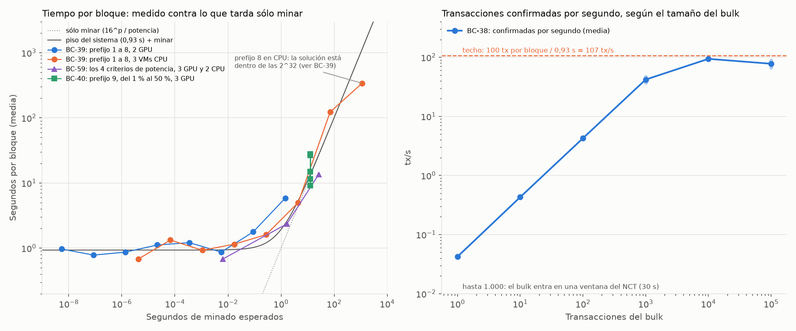

# Análisis de desempeño y escalabilidad (BC-42)

Cruza los resultados de las pruebas del Pilar 3: bulks (BC-38), prefijo (BC-39), fragmentación (BC-40), entrada y salida de GPU (BC-41) y criterio de potencia (BC-59). El detalle de cada una (condiciones, tablas y gráficos propios) está en el [README de las pruebas](README.md). Todos los gráficos se rehacen desde los CSV con `python pilar3/pruebas/graficos.py`.

**Dónde corrieron.** En GKE (`us-central1-a`), entre el 17 y el 18/11, todas con el contrato v2 (firmas, coinbase y shares):
- Un nodo `e2-standard-2` spot por nodegroup: infra (RabbitMQ ×3, Redis ×3, Traefik, KEDA y la observabilidad) y apps (frontend, backend, NCT, TrP y gateway ×2, y el escalador).
- Las GPU, fuera de GCP: la RTX 4060 del k3s de una PC del grupo y T4 de Colab.
- Las CPU, en VMs `e2-highcpu-2` que crea el escalador.

## El modelo: cuánto tarda un bloque

Con todas las corridas en un mismo gráfico (izquierda), el tiempo por bloque sigue la curva

> **t ≈ 0,93 s + 16^p / potencia**

donde 16^p es la cantidad esperada de intentos para un prefijo de p caracteres y la potencia es la suma de los `bench` de los mineros vivos.

- **0,93 s es el piso del sistema.** Es la mediana de los 50 bloques de BC-39 en los que minar lleva menos de 50 ms, con GPU y con CPU por igual. Sale de publicar la tarea, partirla en rangos, prestarlos, verificar el nonce y confirmar el bloque en Redis.
  - Lo más probable es que buena parte sea el sondeo: un minero sin trabajo vuelve a pedir `/tasks/next` cada 2 s (`ESPERA_SIN_TRABAJO`). Con 2 o 3 mineros, el primero en preguntar llega en promedio a los 0,5 a 0,7 s. No está medido por separado.
- **Mientras 16^p / potencia sea menor que ~0,5 s, minar no se nota:** con GPU, hasta el prefijo 7; con 3 VMs CPU, hasta el 5. Ahí el bloque tarda ~1 s, haya la potencia que haya.
- **Por encima, manda la potencia:** cada carácter multiplica el tiempo por 16. Con CPU se ve desde el 6 (5 s → 123 s → 340 s) y con GPU desde el 8.
- **Las cinco pruebas caen sobre la misma curva**, aunque las corrieron personas distintas, con mineros distintos y en días distintos. Las excepciones se explican por el espacio de nonces:
  - El prefijo 8 en CPU queda por debajo: con `ESPACIO_NONCES = 2^32 = 16^8`, las tareas que tienen solución la tienen antes del promedio.
  - El prefijo 8 en GPU queda por arriba: el 37 % de las tareas no tienen solución en 2^32 y el NCT las rearma.
  - Desde BC-40 y BC-59 se usa 2^38 y el desvío desaparece.

## Dónde está el cuello de botella en cada caso

| Situación | Cuello de botella | Evidencia |
|---|---|---|
| Bulk chico (1 a 1.000 tx) | La ventana del NCT: arma las cajas cada 30 s | Confirmar 1 tx o 1.000 tarda lo mismo: 21 a 27 s (BC-38) |
| Bulk grande (10.000 y 100.000 tx) | El ingreso y el ciclo del bloque, los dos en ~100 tx/s | Ver [Throughput](#throughput-el-techo-de-100-txs) |
| Varios clientes contra las mismas cuentas | El orden de los nonces | Con 10 VUs, 10.000 tx: 0 de 3 completas (`nonce salteado` al pasar `ESPERA_NONCE` = 60 s). Con 1 VU: completa (BC-38) |
| Prefijo corto para la potencia (GPU ≤ 7, CPU ≤ 5) | El piso del sistema (~0,93 s) | Prefijo 1 a 5: 0,7 a 1,6 s con GPU o CPU (BC-39) |
| Prefijo largo | La potencia de minado | Prefijo 8: 5,8 s con 2 GPU y 340 s con 3 VMs CPU (BC-39) |
| Rangos grandes (25 % y 50 %) | Mineros sin trabajo: hay menos rangos que mineros | Con 50 %: 2 rangos para 3 GPU, 27,7 s por bloque (BC-40) |
| Rangos chicos (1 %) | La sobrecarga de prestar: hasta 111 préstamos por bloque, de ~1,7 s cada uno | 26,5 s por bloque, 13,2 s sin el rearmado (BC-40) |
| Sin GPU | Arrancar una VM CPU | ~2 min sin bloques: 128 a 138 s hasta el primer bloque CPU (BC-41) |
| Redis con la cadena entera en memoria | La RAM del pod | Con ~280.000 tx y 512 Mi de límite, OOMKilled (BC-38). Corregido: 1 Gi, `maxmemory` y `tx:<id>` como puntero, 872 B por transacción (BC-70, v0.3.0) |

### Throughput: el techo de 100 tx/s

El gráfico de la derecha muestra las transacciones confirmadas por segundo según el tamaño del bulk.

- **Hasta 1.000 transacciones crece lineal con el tamaño:** el bulk entra entero en una ventana del NCT y tarda siempre ~24 s, así que el throughput es sólo tamaño / 24 s.
- **Desde 10.000 se aplana en el techo que pone el piso:** el NCT confirma de a un bloque, con hasta 100 transacciones (`TX_POR_CAJA`), y cada bloque tarda al menos 0,93 s. El techo es 100 / 0,93 ≈ **107 tx/s**.
  - 10.000 tx confirmaron a **93,9 tx/s**, en 102 bloques de ~1,04 s.
  - Las dos de 100.000 dieron 87,8 y 67,5 tx/s. La segunda tuvo bloques de 1,45 s, con la cadena más cargada (sin reiniciar entre corridas). Con 2 corridas no alcanza para atribuir la diferencia.
- **El ingreso está en el mismo orden.** El backend publica cada transacción del lote en RabbitMQ y espera la confirmación del quórum de a una (`confirm_delivery`, ~10 ms por transacción). Con 1 VU trabaja un solo pod a la vez: 10.000 tx se mandaron a ~115 tx/s y 100.000 a ~93 tx/s.

**Con esta arquitectura, el sistema confirma unas 100 tx/s, y agregar mineros no lo cambia.** Mientras el prefijo sea corto, el bloque ya está en el piso. Para subirlo habría que tocar los dos topes a la vez:
- **Confirmación:** más transacciones por bloque (`TX_POR_CAJA`) o armar el bloque siguiente mientras se mina el actual.
- **Ingreso:** publicar el lote con confirmaciones en tanda en vez de una por una, y repartir los lotes entre los pods con un cliente por cuenta, para no romper el orden de los nonces.

## Cómo escala

- **Con la potencia de minado: lineal, mientras minar domine.**
  - Pasar de 1 a 2 GPU (de 1,95 a 3,0 GH/s, ×1,54) bajó el prefijo 8 de 9,4 a 5,8 s (×1,62; BC-39 contra la corrida del 13/11).
  - GPU contra CPU: una RTX 4060 (~2,1 GH/s) equivale a ~1.700 VMs `e2-highcpu-2` (~1,25 MH/s cada una).
  - Por debajo del piso, sumar mineros no acelera nada.
- **Con la dificultad: exponencial,** ×16 por carácter. Por eso el ajuste (BC-60) sube o baja de a un carácter.
  - El criterio de la suma (BC-59) es el único que apunta al objetivo: 13,6 s medidos para 26,3 teóricos. El promedio, el máximo y el mínimo eligen 1 a 3 caracteres menos.
- **Con la fragmentación: en U.** El óptimo está donde hay más rangos que mineros, pero cada rango dura bastante más que pedirlo.
  - Con 3 GPU, ese óptimo es el 10 % (el valor por defecto): 9,2 s por bloque, contra 26,5 s con 1 % y 27,7 s con 50 %.
  - Con más mineros, el óptimo se corre hacia rangos más chicos: hace falta que la cantidad de rangos (100 / %) supere a la de mineros.
- **Con mineros que entran y salen: estable, pero con ~2 minutos de hueco.**
  - Al irse la GPU, el escalador tarda lo mismo en los 3 ciclos (128 a 138 s hasta el primer bloque CPU) y nunca pidió VMs de más.
  - Casi todo ese tiempo es la espera anti-oscilación de 30 s, el `tofu apply` (~10 s) y el arranque y bench del minero (~45 s).
  - Al volver la GPU, la VM sigue viva ~3 minutos y el escalador otros 3 (`cooldownPeriod`).
- **Con los servicios:** cada uno tiene 2 réplicas. Los topes que aparecieron son de diseño (la ventana, las transacciones por bloque, la confirmación de a una y el orden de los nonces), así que agregar réplicas no los mueve. El uso de CPU de los pods durante las pruebas no se midió.

## Configuración recomendada

| Parámetro | Valor | Por qué |
|---|---|---|
| `FRAGMENTO_PORCENTAJE` | 10 % mientras haya menos de 10 mineros; más chico si hay más | El mínimo de la U de BC-40 |
| `CRITERIO_POTENCIA` | suma (el valor por defecto) | El único que apunta al tiempo objetivo (BC-59) |
| Prefijo | Que 16^p / potencia sea bastante mayor que 0,93 s: con 3 GPU (5,4 GH/s), p = 9 (~13 s) | Así el piso pesa menos del 10 % del bloque y el ajuste tiene margen |
| `ESPACIO_NONCES` | 2^38 o más cuando p ≥ 8 | Con 2^32 y p = 8, el 37 % de las tareas no tiene solución y se rearma |
| Clientes que mandan bulks | Un cliente por cuenta origen, o lotes en orden | Si no, `nonce salteado` (BC-38) |
| Redis | 1 Gi de límite y `maxmemory`, con `tx:<id>` como puntero (v0.3.0) | Sin eso, ~280.000 transacciones lo tiraban |
| Escalador | Los 30 s de espera para subir y los 120 s para bajar | No osciló en 3 ciclos; acortarlos acelera ~30 s a cambio de VMs efímeras |

## Limitaciones

- **La cuenta de GCP tiene cuota de 0 GPU** y 32 vCPU en todas las regiones, así que las GPU estuvieron fuera de la nube:
  - La RTX 4060 es la PC de un integrante, compartida con otras tareas: su `bench` varió entre 0,69 y 2,12 GH/s según el día.
  - Las T4 de Colab cortan la sesión: en BC-38 una se desconectó a mitad de la prueba y se siguió con 2.
  - El cluster K3s con GPU de la cátedra no se usó.
- **El cluster es mínimo:** un nodo spot `e2-standard-2` por nodegroup, para gastar poco. No se probó si con más nodos los servicios escalan, ni cómo se comporta con un nodo preemptado a mitad de una prueba.
- **Pocas repeticiones.** El tiempo hasta encontrar un nonce es exponencial, así que con 5 bloques por punto la dispersión es del orden de la media (con CPU, prefijo 7, de 22 a 169 s). Las tendencias se sostienen, pero la diferencia entre 5 % y 25 % en BC-40, por ejemplo, no.
- **Versiones distintas.** BC-38 y BC-59 corrieron el 17/11 sobre `dev`, antes de la 0.2.0 (BC-59 emulando el criterio con `--emular`); BC-39 y BC-41, con la 0.2.0; BC-40, con la 0.3.0. Ninguna diferencia entre versiones cambió el piso: hasta el prefijo 7, los tiempos de la v1 (13/11) y de la v2 son del mismo orden.
- **No se midió por separado qué compone el piso** (sondeo, TrP, verificación y Redis). Es lo primero que habría que instrumentar para bajarlo.

## Conclusiones

1. **El tiempo de un bloque es un piso fijo del sistema más el minado:** t ≈ 0,93 s + 16^p / potencia. Las cinco pruebas lo confirman.
2. **La red escala con la potencia de minado sólo cuando la dificultad es alta.** Con dificultad baja, el límite es el sistema, no los mineros.
3. **El throughput de transacciones no depende de los mineros:** lo fija el piso por bloque y las 100 transacciones por bloque (~100 tx/s), igual que el ingreso, que confirma de a una. Para ir más rápido hay que cambiar el diseño, no sumar máquinas.
4. **La fragmentación tiene un óptimo** cuando hay más rangos que mineros y cada rango dura mucho más que pedirlo. Con 3 GPU, el 10 % por defecto fue el mejor.
5. **El sistema es elástico ante la caída de las GPU:** recupera el minado con CPU en ~2 minutos sin intervención y libera la VM cuando vuelven. El hueco se puede acortar, pero no eliminar mientras la VM se cree recién cuando hace falta.
