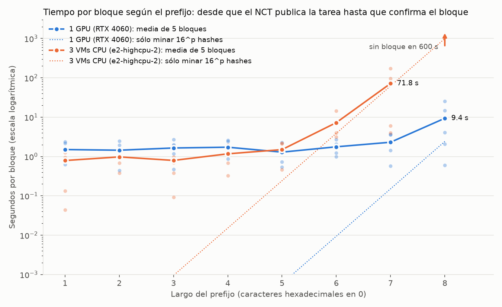

# Pruebas del sistema en GKE

## Prefijo de 1 a 8 caracteres (BC-39)

[`prefijos.py`](prefijos.py) fija el prefijo del TrP (`PREFIJO_BASE=n`, `AJUSTAR_PREFIJO=0`), manda una transacción por bloque y toma de los logs del NCT el tiempo desde que publica la tarea hasta que confirma el bloque (si la tarea vuelve sin solución, desde la primera publicación). Al terminar deja el TrP como estaba.

```bash
python pilar3/pruebas/prefijos.py --api http://<traefik> --salida resultados/prefijos-gpu.csv
python pilar3/pruebas/prefijos.py --api http://<traefik> --salida resultados/prefijos-cpu.csv --tipo cpu --maximo 600
python pilar3/pruebas/grafico_prefijos.py
```

13/11, 5 bloques por largo: GPU con la RTX 4060 del k3s; CPU con 3 VMs e2-highcpu-2 (el escalador con `PREFIJO_BASE=8` durante la corrida, para que pida el máximo).



| Prefijo | 1 GPU | 3 VMs CPU |
|---|---|---|
| 1 a 5 | 1,3 a 1,7 s | 0,8 a 1,5 s |
| 6 | 1,8 s | 7,3 s |
| 7 | 2,3 s | 72 s |
| 8 | 9,4 s | sin bloque en 600 s |

- Hasta 5 caracteres no se mide el minado sino el resto del sistema (RabbitMQ, TrP, sondeo del minero, confirmación en Redis).
- Con CPU se ve el ×16 por carácter desde el 6; con 8 harían falta ~17 min y el NCT vence la tarea a los 10 (`TAREA_VENCE`).
- Con 8 caracteres hacen falta 16⁸ = 2³² intentos, el mismo tamaño que `ESPACIO_NONCES`: 3 de 8 tareas no tuvieron solución (e⁻¹ ≈ 37 %) y el NCT las rearmó con otro timestamp.
