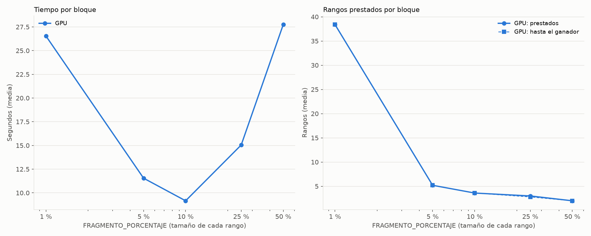
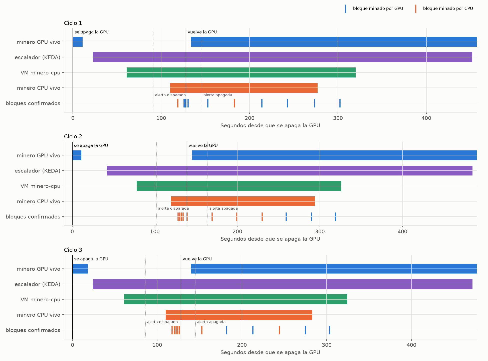
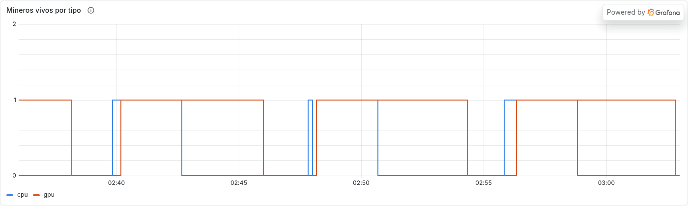
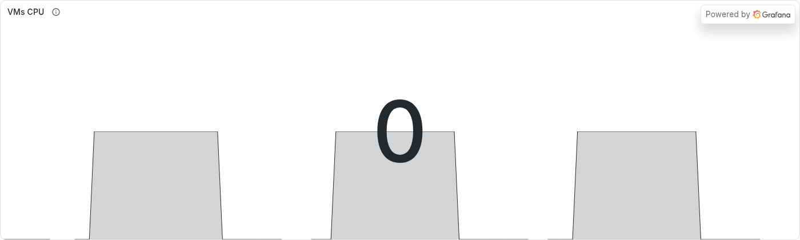
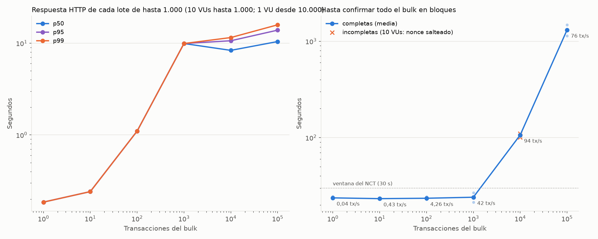
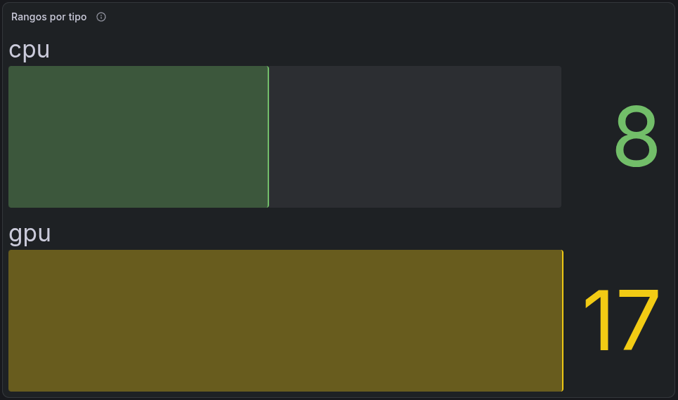
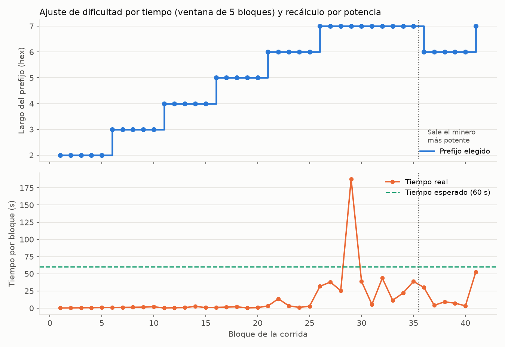

# Pruebas de carga y escalabilidad (BC-38 a BC-42, BC-59, BC-76, BC-85)

| Carpeta / archivo | Qué es |
|---|---|
| [`bulks/`](bulks/README.md) | BC-38: bulks de 1 a 100.000 transacciones con k6 |
| [`prefijos.py`](prefijos.py) y `grafico_prefijos.py` | BC-39: prefijo de 1 a 8 caracteres |
| [`fragmentos.py`](fragmentos.py) | BC-40: fragmentación del pool del 1 % al 50 % |
| [`gpu_ciclos.py`](gpu_ciclos.py) | BC-41: entrada y salida de GPU (ciclos sale la GPU → VM CPU → vuelve la GPU → VM borrada) |
| [`graficos.py`](graficos.py) | BC-42: los gráficos comparativos de todas las pruebas, desde sus CSV |
| [`ANALISIS.md`](ANALISIS.md) | BC-42: el análisis de desempeño y escalabilidad que cruza todas las pruebas, con sus conclusiones |
| [`dificultad.py`](dificultad.py) y `grafico_dificultad.py` | BC-60: ajuste de dificultad (convergencia y caída sin GPU) |
| [`potencia_teorica.py`](potencia_teorica.py), [`potencia.py`](potencia.py) y `grafico_potencia.py` | BC-59: criterio de potencia (suma, promedio, mínimo o máximo) |
| [`trampas.py`](trampas.py) | BC-76: mineros que mienten a propósito contra el sistema desplegado |
| [`operador.py`](operador.py) | BC-85: lo que haría el operador de la nube (tocar Redis, editar o reescribir bloques, inflar shares, un validador que firma dos historias) y que se note |
| [`rafaga.sh`](rafaga.sh) | Una ráfaga: N transferencias firmadas en ronda entre alice, bob y carol, y su seguimiento |
| [`rafaga.py`](rafaga.py) | La misma ráfaga con ventana: el ritmo (transferencias por segundo) se mueve en vivo, hay botones para tirar varias juntas y muestra las que esperan bloque, las confirmadas y un gráfico de los últimos 60 s |
| [`firmar.py`](firmar.py) | Lo que usan las pruebas para firmar: el contrato y las cuentas de prueba del génesis |
| `preparar.sh` | Deja GKE en las condiciones de una prueba y después lo vuelve a la normalidad |

Los scripts que miran qué mineros están vivos los leen del gateway (`GET /mineros`; la API de la app no los expone, BC-54): `--gateway http://<IP del gateway>:8081` o la variable `GATEWAY_URL`.

## Preparar GKE: workflow «Pilar 3 · Preparar prueba»

Se corre a mano: **Actions → Pilar 3 · Preparar prueba → Run workflow**. Entra al cluster con la misma cuenta de los pipelines (WIF), corre [`preparar.sh`](preparar.sh) y deja en el resumen la IP pública, la altura de la cadena, los saldos, los mineros vivos y las condiciones del TrP.

| Acción | Qué hace |
|---|---|
| `estado` | Sólo muestra; no cambia nada |
| `preparar` | Fija `PREFIJO_BASE`, `AJUSTAR_PREFIJO`, `FRAGMENTO_PORCENTAJE` y, si se elige, `CRITERIO_POTENCIA` en el TrP (y el mismo prefijo en el escalador). Opcionales: reiniciar la cadena y dejar una cantidad fija de VMs |
| `restaurar` | TrP y escalador como en los manifiestos, y el escalador de nuevo en manos de KEDA |

**Reiniciar la cadena** (escribir `REINICIAR` en el campo): apaga el NCT y el TrP, vacía las colas y Redis, y los vuelve a prender. El NCT carga el génesis con los `SALDOS_INICIALES` de su Deployment, que en GKE son 1.000.000.000 por usuario ([`nct-saldos.yaml`](../k8s/apps/nct-saldos.yaml)). Se pierden todos los bloques y saldos anteriores, para todo el grupo. Se niega si el NCT todavía tiene los saldos por defecto.

**VMs fijas** (`vms_cpu`): pausa el escalador en KEDA (`autoscaling.keda.sh/paused-replicas: "0"`), aplica `vms/instancias` con esa cantidad y espera a que los mineros CPU avisen. Sin esto, el escalador apaga las VMs a los 2 minutos sin trabajo y las vuelve a crear en la corrida siguiente: cambia la cantidad de mineros entre corridas. Si hay una GPU viva, con `vms_cpu` vacío el escalador no levanta ninguna.

Mientras se mide **nadie mergea a `main`**: el Pipeline 3 volvería a aplicar los manifiestos y cambiaría el prefijo en medio de la prueba. Al terminar, `restaurar`.

Desde una PC con `kubectl` apuntando al cluster es lo mismo:

```bash
pilar3/pruebas/preparar.sh estado
pilar3/pruebas/preparar.sh reiniciar
pilar3/pruebas/preparar.sh condiciones 5 0 10        # PREFIJO_BASE, AJUSTAR_PREFIJO, FRAGMENTO_PORCENTAJE
pilar3/pruebas/preparar.sh condiciones 8 1 10 minimo # … y CRITERIO_POTENCIA (BC-59)
PROYECTO=<proyecto de GCP> pilar3/pruebas/preparar.sh fijar-vms 1
pilar3/pruebas/preparar.sh restaurar
```

## Bulks de 1 a 100.000 transacciones (BC-38)

Los scripts [`bulks/correr.py`](bulks/correr.py) y [`bulks/bulk.js`](bulks/bulk.js) mandan lotes firmados de hasta `1000` transacciones (`alice, bob, carol`) con k6 y miden tanto HTTP (`p50`, `p95`, `p99`, `req/s`, errores) como confirmación completa en bloques. Ver condiciones, tabla completa y análisis en [`bulks/README.md`](bulks/README.md#resultados-1711-en-gke) y datos en [`bulks/resultados.csv`](bulks/resultados.csv).

- **17/11 en GKE** (`PREFIJO_BASE=5`, `AJUSTAR_PREFIJO=0`, `FRAGMENTO_PORCENTAJE=10`):
  - De `1` a `1.000` (`VUS=10`, `3` GPU): `12/12` completas en `21,4–26,8 s` (domina `VENTANA_SEGUNDOS=30` del NCT; `p50` HTTP lineal de `185 ms` a `9,92 s` por `confirm_delivery` transacción por transacción en RabbitMQ).
  - En `10.000` con `VUS=10` (`2` GPU): `0/3` completas por **`nonce salteado`** al intercalarse los 10 lotes (`49–67 s`) por encima de `ESPERA_NONCE=60 s` del NCT.
  - Con `--vus 1` (`2` GPU): **`10.000`** (`1/1`) confirmó en `106,5 s` (`93,9` tx/s) y **`100.000`** (`2/3`) en `1139,5 s` y `1481,9 s` (`1016` y `1024` bloques, envío y minado en paralelo). La 3.ª de `100.000` cayó (`46 %` fallidos / `503`) al alcanzar Redis su `limits.memory: 512Mi` (`OOMKilled`) tras ~`280k` transacciones acumuladas sin reiniciar la cadena.

## Prefijo de 1 a 8 caracteres (BC-39)

[`prefijos.py`](prefijos.py) fija el prefijo del TrP (`PREFIJO_BASE=n`, `AJUSTAR_PREFIJO=0`), manda una transacción por bloque y toma de los logs del NCT el tiempo desde que publica la tarea hasta que confirma el bloque (si la tarea vuelve sin solución, desde la primera publicación). Al terminar deja el TrP como estaba.

```bash
# GPU: sólo mineros GPU vivos
pilar2/.venv/bin/python pilar3/pruebas/prefijos.py --api https://<ingreso> --salida pilar3/pruebas/resultados/prefijos-gpu.csv
# CPU: sin GPU vivas (la del k3s en 0 réplicas, Colab cortado) y 3 VMs fijas
GOOGLE_OAUTH_ACCESS_TOKEN=$(gcloud auth print-access-token) PROYECTO=<proyecto> pilar3/pruebas/preparar.sh fijar-vms 3
pilar2/.venv/bin/python pilar3/pruebas/prefijos.py --api https://<ingreso> --salida pilar3/pruebas/resultados/prefijos-cpu.csv --tipo cpu --maximo 600
pilar3/pruebas/preparar.sh restaurar   # el escalador borra las VMs cuando vuelve la GPU
python pilar3/pruebas/grafico_prefijos.py
```

**18/11, en GKE con la v0.2.0** (contrato v2: firmas, coinbase y shares), 5 bloques por largo, `ESPACIO_NONCES = 2^32` y 10 % por rango:
- **GPU:** la RTX 4060 del k3s (`minero-gpu-0`, bench 1,95 GH/s) y una T4 de Colab (1,06 GH/s): 3,0 GH/s en total.
- **CPU:** 3 VMs e2-highcpu-2 (`minero-cpu-0..2`, bench 1,25-1,29 MH/s cada una): 3,8 MH/s en total.


| Prefijo | 2 GPU: media (mín. a máx.) | 3 VMs CPU: media (mín. a máx.) | Sólo minar 16^p: GPU / CPU |
|---|---|---|---|
| 1 a 5 | 0,8 a 1,2 s (0,2 a 2,4) | 0,7 a 1,6 s (0,1 a 2,4) | < 1 ms / < 0,3 s |
| 6 | 0,9 s (0,4 a 1,7) | 5,0 s (3,8 a 5,9) | 6 ms / 4,4 s |
| 7 | 1,8 s (0,5 a 2,9) | 123 s (22 a 169) | 0,1 s / 70 s |
| 8 | 5,8 s (1,3 a 11), 4 rearmados | 340 s (140 a 565), 0 rearmados | 1,4 s / 1.130 s |

Datos: [`prefijos-gpu.csv`](resultados/prefijos-gpu.csv) y [`prefijos-cpu.csv`](resultados/prefijos-cpu.csv), con sus logs.

- **Hasta 5 caracteres (GPU hasta 7) no se mide el minado sino el resto del sistema:** publicar la tarea, prestar los rangos, el sondeo del minero, verificar y confirmar en Redis. Es ~1 s, con o sin GPU.
- **Con CPU se ve el ×16 por carácter desde el 6:** 5 s → 123 s → 340 s. Con GPU recién se nota en el 8.
- **Con 8 caracteres hacen falta 16⁸ = 2³² intentos, el mismo tamaño que `ESPACIO_NONCES`.**
  - Una tarea no tiene solución con probabilidad e⁻¹ ≈ 37 %: la GPU recorre las 2³² en ~1,4 s y el NCT la rearma con otro timestamp. Hubo 4 rearmados en 9 tareas, y por eso la media (5,8 s) es mayor que lo que tarda en minar.
  - Con CPU no hubo ninguna sin solución en 5 (probabilidad 0,63⁵ ≈ 10 %). Si hubiera habido una, recorrer las 2³² le lleva ~19 min y el NCT la vence a los 10 (`TAREA_VENCE_SEGUNDOS`).
  - Cuando la tarea tiene solución, está dentro de las 2³² y se encuentra antes que el promedio sin tope: se espera 0,42 × 2³² intentos, ~470 s con 3,8 MH/s. Por eso con CPU la media medida (340 s) queda por debajo de los 1.130 s de 16⁸ / potencia.
- El tiempo hasta encontrar el nonce es exponencial: con 5 bloques la dispersión es grande (con CPU, prefijo 7, de 22 a 169 s).
- **Contra el 13/11** (v1, 1 RTX y 3 VMs; los CSV viejos quedan en el historial de git): la GPU con prefijo 8 bajó de 9,4 a 5,8 s con la segunda placa; el prefijo 8 con CPU, que entonces no salió en 600 s, ahora salió 5 de 5. Hasta el 7 los tiempos son del mismo orden: la v2 (firmas, coinbase y shares) no agregó una demora que se note.

## Fragmentación del 1 % al 50 % (BC-40)

[`fragmentos.py`](fragmentos.py) fija el prefijo (sin ajuste) y recorre `FRAGMENTO_PORCENTAJE` (por defecto 1, 5, 10, 25 y 50). Manda una transacción por bloque y mide:

- de los logs del NCT, el tiempo por bloque, igual que `prefijos.py`;
- de los del TrP, en cuántos rangos se partió la tarea y en cuál cayó el nonce ganador;
- de los del gateway, los rangos prestados (en total y hasta que llegó el ganador), los cortados a medio minar, los descartados sin prestar, los vencidos y cuántos tuvo cada minero.

Al terminar, deja el TrP como estaba.

```bash
# GPU: sólo mineros GPU vivos (la corrida del 18/11)
pilar2/.venv/bin/python pilar3/pruebas/fragmentos.py --api https://<ingreso> --salida pilar3/pruebas/resultados/fragmentos-gpu.csv --prefijo 9 --espacio $((2**38))
# CPU (opcional): sin GPU vivas y 3 VMs fijas
pilar2/.venv/bin/python pilar3/pruebas/fragmentos.py --api https://<ingreso> --salida pilar3/pruebas/resultados/fragmentos-cpu.csv --tipo cpu
python pilar3/pruebas/graficos.py fragmentos
```

- `prestados_hasta_ganar - 1` es el trabajo desperdiciado, contado en rangos y no en hashes: de un rango cortado no se sabe cuánto se llegó a minar.
- Con `ESPACIO_NONCES = 2^32`, un rango del 1 % tiene ~43 M de nonces. Con prefijo 6 (~16 M intentos), en CPU la solución cae casi siempre en el primer rango que agarra cada minero, así que no se ve la sobrecarga de los rangos chicos. Para verla: GPU con prefijo 7 u 8, o un `--espacio` más chico. Con eso sube la probabilidad de una tarea sin solución, e^(−espacio/16^prefijo).
- En CPU conviene `preparar.sh fijar-vms N` con N ≥ 3: con 50 % hay sólo 2 rangos y se ve un minero sin trabajo.

**18/11, en GKE con la v0.3.0**, 5 bloques por %, prefijo 9 fijo y `ESPACIO_NONCES = 2^38` (como en BC-59: con 16⁹ = 2³⁶ intentos, queda sin solución ~1,8 % de las tareas). Tres GPU, con el `bench` que registró cada una: la RTX 4060 de Tomas (`7c62b51a90c2`, 2,12 GH/s), y dos T4 de Colab (`gpu-colab-mateo`, 1,66 GH/s, y `gpu-colab-tomas-1`, 1,65 GH/s): 5,4 GH/s en total. Sólo minar 16⁹ con las tres tarda en promedio ~13 s.



| % | Rangos por tarea | Nonces por rango (T4) | Tiempo: media (mediana; mín. a máx.) | Prestados por bloque | Mineros con rango |
|---|---|---|---|---|---|
| 1 | 100 | 2.750 M (~1,7 s) | 26,5 s (8,8; 3,9 a 79,9), 1 rearmado | 38,4 | 3 |
| 5 | 20 | 13.700 M (~8 s) | 11,5 s (13,4; 0,9 a 17,7) | 5,2 | 2,6 |
| **10** | 10 | 27.500 M (~17 s) | **9,2 s (4,7; 2,1 a 25,4)** | 3,6 | 3 |
| 25 | 4 | 68.700 M (~42 s) | 15,0 s (7,3; 1,5 a 31,4) | 3,0 | 3 |
| 50 | 2 | 137.400 M (~83 s) | 27,7 s (21,5; 2,0 a 55,3) | 2,0 | **2** |

Datos: [`fragmentos-gpu.csv`](resultados/fragmentos-gpu.csv) y su [log](resultados/fragmentos-gpu.log).

- **Con rangos grandes trabajan pocos mineros.** Con 50 % hay 2 rangos para 3 GPU: en los 5 bloques una quedó sin trabajo, se minó con dos tercios de la potencia (~19 s esperados) y, si el nonce cae lejos del principio de un rango, nadie ayuda a recorrerlo (55 y 51 s). Con 25 % hay 4 rangos y minan las tres, pero el cuarto queda para la primera que termina: si el nonce está ahí, se espera a que alguna recorra uno entero.
- **Con rangos chicos sube la sobrecarga.** Con 1 %, cada rango dura ~1,7 s en una T4 y por bloque hubo hasta 111 préstamos: cada uno es un `GET /tasks/next` firmado, keep-alives y un resultado, y entre un rango y el siguiente la GPU no mina. Con rangos de 1,7 s, ese ida y vuelta pesa.
- **El 10 % (el valor por defecto del TrP) fue el mejor:** más rangos que mineros, así que nadie queda parado, y cada uno dura lo suficiente (~17 s) como para que pedirlo no pese. Su media (9,2 s) está cerca de lo que tarda sólo minar (~13 s): por debajo, por el ruido de 5 bloques.
- **El trabajo desperdiciado es poco en todos los %:** `prestados_hasta_ganar` coincide con `prestados` en 24 de 25 bloques (cuando llega el ganador casi no se presta nada más) y los rangos cortados a medio minar son 0 a 2 por bloque, uno por minero que estaba en otro rango. Lo que cambia con el % es cuánto se pierde en cada corte: con 50 % es un rango de 83 s.
- **El ruido es grande:** el tiempo hasta encontrar el nonce es exponencial, así que con 5 bloques la dispersión es del orden de la media. La U se ve igual en la mediana (8,8 → 13,4 → 4,7 → 7,3 → 21,5 s), aunque el 5 % sale peor que el 25 %: con más bloques se ordenaría mejor.
- **El rearmado del 1 %:** en el bloque 4 la primera tarea no tenía solución en las 2³⁸ (la probabilidad es ~1,8 %). Los mineros la recorrieron entera, el NCT la rearmó con otro timestamp y se encontró en el rango 10 de la segunda: 79,9 s y 111 préstamos. Sin ese bloque, la media del 1 % es 13,2 s.
- **Reparto entre mineros:** parejo en todos los %. El préstamo es por pedido (el que termina pide otro) y no por potencia, así que con muchos rangos la más rápida debería recibir más. Con 1 % no pasó (38, 39 y 34 rangos) aunque el bench de la RTX es ~28 % mayor: la RTX es la PC de Tomas, compartida, y durante la corrida pudo minar por debajo de su bench.

## Entrada y salida de GPU (BC-41)

[`gpu_ciclos.py`](gpu_ciclos.py) apaga el minero GPU del k3s (`kubectl scale --replicas=0`), mide cómo el sistema pasa a una VM CPU y lo vuelve a prender. Cada 5 s anota los mineros vivos por tipo, las VMs `minero-cpu-*` (gcloud), los pods del escalador y la alerta `SinMinerosGPU` (Prometheus). Mientras no hay GPU, manda una transferencia de alice cada vez que se confirma la anterior: siempre hay trabajo. Al borrarse la VM deja de mandar y mide cuánto tarda KEDA en apagar el escalador.

```bash
# Sólo los GPU del StatefulSet vivos (Colab cortado), sin VMs y con el escalador en manos de KEDA
pilar2/.venv/bin/python pilar3/pruebas/gpu_ciclos.py --api https://<ingreso> --ciclos 3 \
    --proyecto <proyecto> --salida pilar3/pruebas/resultados/gpu-ciclos
python pilar3/pruebas/graficos.py gpu
```

**18/11, en GKE con la v0.2.0**, 3 ciclos. La RTX 4060 del k3s como única GPU. El escalador con sus valores normales: `PREFIJO_BASE=6`, 60 s por bloque, sube tras 30 s sin GPU y baja tras 120 s. Datos: [`gpu-ciclos-eventos.csv`](resultados/gpu-ciclos-eventos.csv), [`-muestras.csv`](resultados/gpu-ciclos-muestras.csv) y [`-bloques.csv`](resultados/gpu-ciclos-bloques.csv), con su log.



| Sale la GPU (t = 0) | Ciclo 1 | Ciclo 2 | Ciclo 3 | Por qué |
|---|---|---|---|---|
| El gateway la da por muerta | 17 s | 17 s | 24 s | Sin keepalive en 15 s (`vivo_segundos`), más el período de muestreo |
| KEDA prende el escalador | 29 s | 48 s | 30 s | Trigger «tx en cajas» o «rangos sin tomar», con `pollingInterval` 15 s |
| Alerta `SinMinerosGPU` pendiente → disparada | 36 → 97 s | 48 → 108 s | 36 → 92 s | `for: 1m` |
| VM creada → corriendo | 67 → 73 s | 84 → 90 s | 67 → 80 s | El escalador espera 30 s sin GPU (`ESPERA_SUBIR_SEGUNDOS`) y aplica |
| Minero CPU vivo (después de su bench) | 117 s | 126 s | 116 s | Arranque de COS, bajar la imagen y la tarea modelo (2^24 hashes, ~13 s en CPU) |
| **Primer bloque minado por CPU** | **128 s** | **138 s** | **128 s** | |

| Vuelve la GPU (t = 0) | Ciclo 1 | Ciclo 2 | Ciclo 3 | Por qué |
|---|---|---|---|---|
| GPU viva | 12 s | 13 s | 18 s | Arranque del pod, `hello` y bench |
| Alerta apagada | 24 s | 32 s | 23 s | |
| Primer bloque minado por GPU | 6 s | 131 s | 66 s | Con prefijo 1-2 la CPU también gana bloques |
| Minero CPU dado por muerto | 155 s | 161 s | 161 s | 120 s con GPU (`ESPERA_BAJAR_SEGUNDOS`) + `tofu destroy` |
| **VM borrada** | **192 s** | **187 s** | **196 s** | |
| Escalador apagado (desde que dejan de llegar transacciones) | 175 s | 192 s | 189 s | `cooldownPeriod` 180 s de KEDA |

Capturas de Grafana del mismo período (horario de Argentina, 02:36 a 03:03):





- **Sin GPU, la red tarda ~2 minutos en volver a minar**, y casi todo es arrancar la VM: los 30 s que el escalador espera para no oscilar, ~10 s del `tofu apply` hasta la VM corriendo y ~45 s hasta que el minero arranca y hace su bench. Los tres ciclos dan parecido (10 a 20 s de diferencia, sobre todo por el sondeo de KEDA cada 15 s): el escalador no se traba ni pide VMs de más.
- **Al volver la GPU, la VM vive ~3 minutos más:** los 120 s de espera antes de bajar y el `destroy`. El escalador sigue prendido otros 3 minutos (`cooldownPeriod`) después de que no queda trabajo. Al final no quedó ninguna VM ni clave de minero CPU aprobada: el escalador las da de baja al borrarlas.
- **Cuánto baja el prefijo.** Si al armar una tarea no hay ningún minero vivo, el TrP elige 1 (`largo_prefijo`): el primero que llegue lo resuelve enseguida.
  - En el ciclo 1 la tarea se armó antes de que la GPU se diera por muerta y quedó en 6.
  - En los ciclos 2 y 3 bajó a 1, y después **sube de a 1 cada 5 bloques** (`VENTANA_AJUSTE`, `AJUSTE_MAXIMO=1`): pasada la prueba seguía en 2, aunque ya estaba la GPU.
  
  Es lo que pide BC-60 (no saltar de golpe), pero deja varios bloques con dificultad mínima. Mejora posible: que al volver a haber mineros el ajuste arranque desde el techo por potencia y no desde el último prefijo.

## Gráficos comparativos (BC-42)

[`graficos.py`](graficos.py) rehace los gráficos desde los CSV de cada prueba, así se pueden repetir: `python pilar3/pruebas/graficos.py` (todos) o `graficos.py bulks gpu` (algunos). Si falta el CSV de uno, lo saltea.

| Gráfico | Datos | Imagen |
|---|---|---|
| Bulks (BC-38): respuesta HTTP p50/p95/p99 y tiempo hasta confirmar contra el tamaño | `bulks/resultados.csv` | [`bulks.png`](resultados/bulks.png) |
| Prefijo (BC-39): tiempo por bloque contra el largo, GPU y CPU | `resultados/prefijos-{gpu,cpu}.csv` | [`prefijos.png`](resultados/prefijos.png) |
| Fragmentación (BC-40): tiempo por bloque y rangos prestados contra el % | `resultados/fragmentos-{gpu,cpu}.csv` | [`fragmentos.png`](resultados/fragmentos.png) |
| Entrada y salida de GPU (BC-41): línea de tiempo de cada ciclo | `resultados/gpu-ciclos-*.csv` | [`gpu-ciclos.png`](resultados/gpu-ciclos.png) |
| Comparativo: tiempo por bloque contra el minado esperado (BC-39, 40 y 59) y tx/s contra el techo (BC-38) | los anteriores y `potencia.csv` | [`desempeno.png`](resultados/desempeno.png) |

El análisis que cruza todas las pruebas (cuellos de botella, cómo escala, configuración recomendada, limitaciones y conclusiones) está en [`ANALISIS.md`](ANALISIS.md).



- **Respuesta HTTP:** crece lineal con el lote hasta 1.000, porque el backend confirma cada transacción en RabbitMQ (`confirm_delivery`) de a una. Desde 10.000 los lotes son de 1.000 y la latencia por lote se mantiene en ~10 s.
- **Confirmación:** hasta 1.000 transacciones manda la ventana de 30 s del NCT (todo entra en un bloque). Desde 10.000 son 100 por bloque (`TX_POR_CAJA`) y el tiempo crece lineal: 76 a 94 tx/s confirmadas.

## Criterio de potencia (BC-59)

El TrP elige el largo p del prefijo con la potencia de los mineros vivos: el mayor p con 16^p ≤ potencia × T (`SEGUNDOS_POR_BLOQUE`), hasta `PREFIJO_BASE`; desde BC-60 ese es el techo del ajuste por tiempo (ver [el README del TrP](../../pilar2/trp/README.md)). La potencia es la **suma** de sus `bench`. `CRITERIO_POTENCIA` permite, sólo para esta prueba, juntarlos con el promedio, el mínimo o el máximo.

Lo importante: **el criterio sólo elige p, pero minan todos**. El bloque tarda en promedio 16^p intentos dividido la potencia **total**, así que la suma es el único criterio que apunta al objetivo. Los otros eligen un p más corto (nunca más largo: el promedio, el mínimo y el máximo son ≤ la suma) y los bloques salen antes de lo buscado.

**Tabla teórica**, sin cluster: [`potencia_teorica.py`](potencia_teorica.py) usa la misma función que el TrP, con los bench de BC-39 (RTX 4060: 1,78 GH/s; VM e2-highcpu-2: 1,44 MH/s) y la T4 de Colab estimada en 700 MH/s (el kernel del Hit 7 en el cierre del Pilar 1), y deja `resultados/potencia-teorica.csv`. La tabla y la medición son con T = 30 s, el objetivo hasta BC-60 (ahora 60 s: algunos grupos suben un carácter). Sin tope:

| Grupo | Suma | Promedio | Mínimo | Máximo |
|---|---|---|---|---|
| 1 CPU | 6 (11,7 s) | 6 (11,7 s) | 6 (11,7 s) | 6 (11,7 s) |
| 3 CPU | 6 (3,9 s) | 6 (3,9 s) | 6 (3,9 s) | 6 (3,9 s) |
| 1 GPU | 8 (2,4 s) | 8 (2,4 s) | 8 (2,4 s) | 8 (2,4 s) |
| 1 GPU y 2 CPU | 8 (2,4 s) | 8 (2,4 s) | **6 (0,009 s)** | 8 (2,4 s) |
| 1 GPU y 15 CPU | 8 (2,4 s) | **7 (0,15 s)** | **6 (0,009 s)** | 8 (2,4 s) |
| 2 GPU | **9 (19 s)** | 8 (1,2 s) | 8 (1,2 s) | 8 (1,2 s) |
| RTX, 2 T4 y 2 CPU (el de la prueba) | **9 (22 s)** | 8 (1,3 s) | **6 (0,005 s)** | 8 (1,3 s) |

- El **mínimo** se separa en cuanto hay una CPU junto a una GPU: el prefijo lo elige el más lento y la GPU lo resuelve enseguida.
- El **promedio** se separa cuando hay muchos mineros: es la suma dividida la cantidad, así que depende de cuántos hay y no de cuánto pueden.
- El **máximo** se separa cuando hay varios mineros fuertes: con 2 GPU elige como si hubiera una.
- En el grupo de la prueba se separan tres: la suma (9), el máximo y el promedio (8) y el mínimo (6). Pasa con cualquier T4 de más de ~0,26 GH/s, así que no depende de la estimación. Sin las CPU, el mínimo sería una T4 y daría 8 como el resto.
- Como p sube de a un carácter (×16), los criterios muchas veces coinciden, y aun con la suma el bloque tarda entre T/16 y T (con 1 GPU, 2,4 s y no 30). Los tiempos teóricos no incluyen el resto del sistema: en BC-39, hasta prefijo 5 un bloque tarda 1 a 2 s igual.

**Medición en GKE**: [`potencia.py`](potencia.py) recorre los criterios con el ajuste prendido (`AJUSTAR_PREFIJO=1`), tope 9, `ESPACIO_NONCES=2^38` (con prefijo 9 hacen falta 2^36 intentos: quedan sin solución ~1,8 % de las tareas en vez de ~37 %) y 10 %, y saca de los logs del TrP el criterio, el prefijo y la potencia de cada tarea. Exige 3 GPU y 2 CPU vivos (`--gpus` y `--cpus` lo cambian). Con un TrP sin `CRITERIO_POTENCIA` (el de `main`), `--emular` lee el `bench` de los vivos del `/mineros` del gateway, calcula con `trp/particion.py` el prefijo de cada criterio y lo fija (`PREFIJO_BASE=p`, `AJUSTAR_PREFIJO=0`): mide lo mismo, porque minan todos igual. Al terminar deja el TrP como estaba. Con la medición, el gráfico calcula lo teórico con la potencia que registró el TrP (la suma) y no con la T4 estimada.

El grupo: la RTX 4060 del k3s, 2 GPU de Colab ([`colab.ipynb`](../../pilar2/minero_gpu/colab.ipynb), cada una con su cuenta aprobada) y 2 VMs CPU fijas. Conviene hacerla en la misma sesión que BC-40, que con varias GPU también se ve mejor: primero `fragmentos.py --tipo gpu` sin VMs, después las VMs y esta.

```bash
# Con la RTX y los 2 Colab prendidos, y el TrP de BC-59 desplegado en GKE
PROYECTO=<proyecto de GCP> pilar3/pruebas/preparar.sh fijar-vms 2
pilar2/.venv/bin/python pilar3/pruebas/potencia_teorica.py
pilar2/.venv/bin/python pilar3/pruebas/potencia.py --api http://<traefik> --salida pilar3/pruebas/resultados/potencia.csv
#   … --emular si el TrP desplegado no es el de BC-59
python pilar3/pruebas/grafico_potencia.py
pilar3/pruebas/preparar.sh restaurar
```


17/11, en GKE con `--emular` (el TrP de `main`, todavía sin `CRITERIO_POTENCIA`), 5 bloques por criterio, sin rearmados. El grupo, con el `bench` que registró cada uno: la RTX 4060 del k3s (`minero-gpu-0`, 0,69 GH/s, compartida), 2 T4 de Colab (0,94 y 0,98 GH/s) y 2 mineros CPU con 2 procesos cada uno (3,0 y 3,1 MH/s). Potencia total: 2,62 GH/s ([`resultados/potencia.csv`](resultados/potencia.csv)).

| Criterio | Potencia | Prefijo | Teórico (16^p / 2,62 GH/s) | Medido: media (mín. a máx.) |
|---|---|---|---|---|
| suma | 2.615 MH/s | 9 | 26,3 s | **13,6 s** (4,1 a 26,7) |
| promedio | 523 MH/s | 8 | 1,6 s | 2,9 s (1,3 a 4,0) |
| máximo | 981 MH/s | 8 | 1,6 s | 1,9 s (0,8 a 2,9) |
| mínimo | 3 MH/s | 6 | 0,006 s | 0,7 s (0,5 a 0,9) |

- **La suma es la única que se acerca al objetivo de 30 s.** El promedio y el máximo eligen un carácter menos y el bloque sale ~16 veces antes; el mínimo, que lo elige una CPU, tres caracteres menos.
- La media de la suma quedó por debajo de lo teórico: con 5 bloques la dispersión es grande (el tiempo hasta encontrar el nonce es exponencial: 4 a 27 s), no es un sesgo.
- Con el mínimo el bloque no tarda 6 ms sino 0,7 s: es lo que tarda el resto del sistema (publicar la tarea, prestar los rangos, verificar y confirmar), como en BC-39 con prefijos cortos.
- Ganaron las tres GPU, ninguna CPU: con estos prefijos, los rangos que agarran las CPU casi nunca llegan a tener la solución antes que una GPU.

### El reparto de rangos en Grafana

Los paneles «Rangos por minero por minuto» y «Rangos por tipo», de la fila «Reparto del trabajo» del dashboard, cuentan los rangos que el gateway le presta a cada minero (`blockchain_minero_rangos_total`). Capturas del 17/11, de 23:19 a 23:30, en GKE con el código de `dev` y las condiciones normales (prefijo 6 fijo, 10 %). El grupo, con su `bench`: la RTX 4060 del k3s (`minero-gpu-0`, 1,44 GH/s), una T4 de Colab (`gpu-colab-tomas`, 0,98 GH/s) y 2 mineros CPU con 2 procesos cada uno (`cpu-mateo-1` y `cpu-mateo-2`, 3,0 y 3,1 MH/s). `gpu-colab-mateo` estaba apagado. Las transacciones las puso [`rafaga.sh`](rafaga.sh) en loop, de a 500.




- **Las GPU se llevaron 17 rangos y las CPU 8**: el doble, con el mismo número de mineros de cada tipo.
- La diferencia es mucho menor que la de potencia (~400 veces: 2,42 GH/s contra 6,1 MH/s). Lo más probable es que sea por el prefijo corto: el bloque sale en 1 a 2 s, así que casi todo el reparto pasa en el primer pedido de cada tarea, cuando todos agarran uno. Ese rango cuenta al prestarse, aunque la CPU no llegue a terminarlo (el TrP lo descarta con «ya resuelta»). Con un prefijo que tarde más, la GPU volvería a pedir muchas veces antes que la CPU.
- Entre 23:23:40 y 23:25:40 todo está en 0: no hubo transacciones pendientes y el TrP no armó tareas.

## Firmas (contrato v2)

Las transacciones van firmadas por su origen y con el nonce de su cuenta. Las pruebas firman con las cuentas de prueba del génesis (alice, bob y carol, de `pilar2/comun/tests/claves.py`), que en GKE tienen saldos altos ([`nct-saldos.yaml`](../k8s/apps/nct-saldos.yaml)). Por eso se corren con el Python de `pilar2` (`pilar2/.venv/bin/python`, o `pip install -r pilar2/comun/requirements.txt`), que tiene `cryptography`.

Una ráfaga: `pilar3/pruebas/rafaga.sh http://<Ingress> 20`, o con ventana: `pilar2/.venv/bin/python pilar3/pruebas/rafaga.py [--sistema https://…]`.

## Ajuste de dificultad (BC-60)

[`dificultad.py`](dificultad.py) arranca la cadena con `PREFIJO_INICIAL=2` y `PREFIJO_BASE=8`, espera que el prefijo vaya subiendo de a 1 cada `VENTANA_AJUSTE` bloques hasta acercarse al objetivo de 60 s (`SEGUNDOS_POR_BLOQUE`), y con `--esperar-gpu` pausa para desconectar la GPU y comprobar la bajada (desde BC-73: en el acto si la potencia cae 4 veces o más, o de a un carácter cada 240 s sin bloque). `PREFIJO_INICIAL` sólo vale con la cadena sin bloques minados: sin reiniciarla, la subida por tiempo se ve en el escenario `bench-bajo` de [la prueba de trampas](#mineros-que-mienten-bc-76). Al terminar deja el TrP en su configuración normal.

```bash
# Correr con cadena limpia (preparar.sh reiniciar antes)
pilar2/.venv/bin/python pilar3/pruebas/dificultad.py --api http://<traefik> --gateway http://<IP>:8081 --salida pilar3/pruebas/resultados/dificultad.csv --esperar-gpu
python pilar3/pruebas/grafico_dificultad.py
```

**19/11, en el k3s con la cadena reiniciada** (v0.6.0 más el arreglo de la medición, #73). Dos mineros CPU locales: uno de 7,8 MH/s y otro de 1,3 MH/s (9,1 MH/s en total); `PREFIJO_INICIAL=2`, `PREFIJO_BASE=8`, 60 s por bloque, ventana de 5. En la fase «sin GPU» se apagó el minero de 7,8 MH/s.



| Bloques | Prefijo | Qué pasó |
|---|---|---|
| 1 a 25 | 2 → 6 | Subió un carácter cada 5 bloques: los bloques salían en 0,2 a 13 s, bien por debajo de 15 s (60 / 4) |
| 26 a 35 | 7 | Equilibrio: 16^7 / 9,1 MH/s ≈ 30 s. La ventana del 26 al 30 promedió 64 s (con uno de 188 s, la varianza de la prueba de trabajo) y el ajuste dio 0 |
| 36 | 6 | Sale el minero rápido: la potencia cae 6 veces y el TrP recalcula en el acto (BC-73), sin esperar bloques lentos |
| 37 a 40 | 6 | Con 1,3 MH/s, bloques de 3 a 9 s |
| 41 | 7 | La ventana del 36 al 40 promedió 11 s: el tiempo lo sube de nuevo (16^7 / 1,3 MH/s ≈ 200 s, dentro del margen de 4 veces) |

La primera corrida de ese día se descartó: mostró que el gateway medía mal los préstamos de menos de 2 s (con prefijo 2, a una CPU de 5,8 MH/s la medía en unos cientos de H/s) y el prefijo saltaba de 2 a 6. Se arregló en #73. La columna `segundos` del CSV es la `duracion` que guarda el NCT; en el bloque 2, los logs habían dado 30 s por confundir la publicación de la tarea anterior (`dificultad.py` ya usa la del NCT).

## Mineros que mienten (BC-76)

[`trampas.py`](trampas.py) corre mineros CPU locales contra el sistema desplegado: uno honesto y los tramposos de [`minero_cpu/trampas.py`](../../pilar2/minero_cpu/trampas.py) (variable `TRAMPA`, apagada por defecto), manda transferencias de alice, bob y carol para que haya bloques, y mira en Redis y en los logs qué hizo el sistema. Aprueba las cuentas de los tramposos con `pilar2/k8s/aprobar.sh` y las da de baja al final.

```bash
KUBECONFIG=~/.kube/config pilar2/.venv/bin/python pilar3/pruebas/trampas.py \
    --gateway http://<IP del gateway>:8081 --backend http://<Ingress>        # [--solo juntos,retener,gpu-falsa,bench-bajo,rangos-ajenos]
```

| Escenario | Quiénes | Qué se comprueba |
|---|---|---|
| `juntos` | Honesto, `bench-alto`, `acaparar`, `retener`, `sin-solucion` y `guardar` | Los dos que contestan «sin solución» quedan suspendidos (BC-75); `acaparar` recibe un solo rango; `bench-alto` cuenta lo medido; el honesto no se suspende (BC-74) |
| `retener` | `retener` y `acaparar`, sin nadie que mine | El plazo les saca el rango (sin medición, a los 120 s): con la tarea abierta, nada más se los puede sacar (BC-74) |
| `gpu-falsa` | Sólo una «GPU» que avisa y nunca pide rangos, con trabajo apilado | El escalador pide VMs igual (BC-74) y, sin bloque en 240 s, el prefijo baja por emergencia (BC-73) |
| `bench-bajo` | Sólo uno que declara la centésima parte de su bench, con `PREFIJO_BASE=8` | El ajuste por tiempo sube el prefijo por encima del techo que da ese bench (BC-73) |
| `rangos-ajenos` | Honesto y uno que en cada tarea manda «sin solución» de los rangos 0 a 9 que no son suyos y de 1000 a 1009, con el prefijo fijo en 7 | Ningún resultado ajeno se acepta (409 y 400), el TrP no da tareas por agotadas y los bloques siguen saliendo (BC-92, la prueba de la devolución) |

Resultados en [`resultados/trampas.csv`](resultados/trampas.csv) y el detalle en [`resultados/trampas.log`](resultados/trampas.log).

**19/11, en el k3s con las imágenes de la v0.6.0: 10 de 10.**
- `sin-solucion` y `guardar` quedaron suspendidos por estadística en el primer rango (P ≈ 7,6×10⁻¹²: rangos de 430 M nonces con prefijo 6).
- `acaparar` pidió 10 rangos seguidos 9 veces y recibió uno solo cada vez. Sin nadie que mine, el plazo les sacó el rango a `retener` y a `acaparar` a los 120 s.
- `bench-alto` declaró 1,18 GH/s y el sistema contó lo medido: 1,34 MH/s. El honesto midió 2,64 MH/s con un bench de 2,19 MH/s (lo medido es una estimación: el sistema usa el menor) y no se lo suspendió.
- Con sólo la «GPU» falsa, el escalador pidió 1 VM y, a los 240 s sin bloque, el prefijo bajó de 6 a 5 por emergencia.
- `bench-bajo` declaró 52,6 kH/s (techo 5). Con el tope en 8, el prefijo de cada bloque fue 5 (ocho bloques), 6 (cinco) y 7: el tiempo pasó el techo. Con la regla anterior se quedaba en 5.

**27/11, `rangos-ajenos` en el k3s con el arreglo de BC-92: 4 de 4.** Se usó la misma prueba de la devolución, con el prefijo fijo en 7 durante 180 s. El atacante atacó 4 tareas y mandó 76 «sin solución» ajenos: el gateway contestó 36 con 409 (rangos que la tarea tiene, pero no eran suyos) y 40 con 400 (los 1000 a 1009). El TrP no dio ninguna tarea por agotada, salieron 3 bloques y el honesto no quedó suspendido. Antes del arreglo, con el prefijo 7 no salía ningún bloque.


## El operador de la nube (BC-85)

[`operador.py`](operador.py) hace de operador tramposo: toca Redis desde un pod del TrP, edita o reescribe bloques con el NCT apagado, infla una lista de shares y hace que un validador firme dos historias. Mira qué ven el NCT, los dos nodos del cluster (`/nodos/0` y `/nodos/1`), un nodo nuevo que arranca de cero y tres validadores locales (puertos 8091 a 8093), y deja todo como estaba. Necesita la cadena v3, la clave de organizador de prueba (la del k3s) y arranca su propio minero CPU.

```bash
KUBECONFIG=~/.kube/config pilar2/.venv/bin/python pilar3/pruebas/operador.py \
    --backend http://localhost --gateway http://localhost:8081   # [--solo saldo,alta,editado,reescrita,epoca,invalido,deshacer,sin-validadores]
```

| Escenario | Qué hace el operador | Qué se comprueba |
|---|---|---|
| `saldo` | `HINCRBY saldos` y gastar lo inventado | El NCT lo rechaza contra la cadena, corrige el caché y lo deja en el log |
| `alta` | `HSET cuentas` sin un alta firmada | La transferencia se rechaza y la revisión saca la cuenta |
| `editado` | Inflar la coinbase del bloque 2 en Redis | Un nodo nuevo rechaza el bloque 2: el hash no sale |
| `reescrita` | Reemplazar la punta por otro bloque minado | Los nodos y los validadores ven el conflicto y no firman |
| `epoca` | 50 shares más para un minero en la lista publicada | La lista no da la raíz que quedó en la cadena |
| `invalido` | Agregar un bloque con una carga sin la firma del organizador | Los nodos lo rechazan y no se finaliza |
| `deshacer` | Reemplazar un bloque finalizado y hacer firmar a un validador | 409 y la prueba de la doble firma; los otros dos no firman; la finalidad no retrocede |
| `sin-validadores` | Apagar los validadores | Los bloques siguen saliendo; al volver, finalizan |

Resultados en [`resultados/operador.csv`](resultados/operador.csv) y el detalle en [`resultados/operador.log`](resultados/operador.log).

**19/11, en el k3s con la v3: 16 de 16.** Lo que el operador sí puede hacer sigue igual: no incluir transacciones, elegir el prefijo y apagar el sistema (ver [el modelo de confianza](../../pilar2/CONTRATO.md#modelo-de-confianza-el-operador-de-la-nube-bc-85)).
