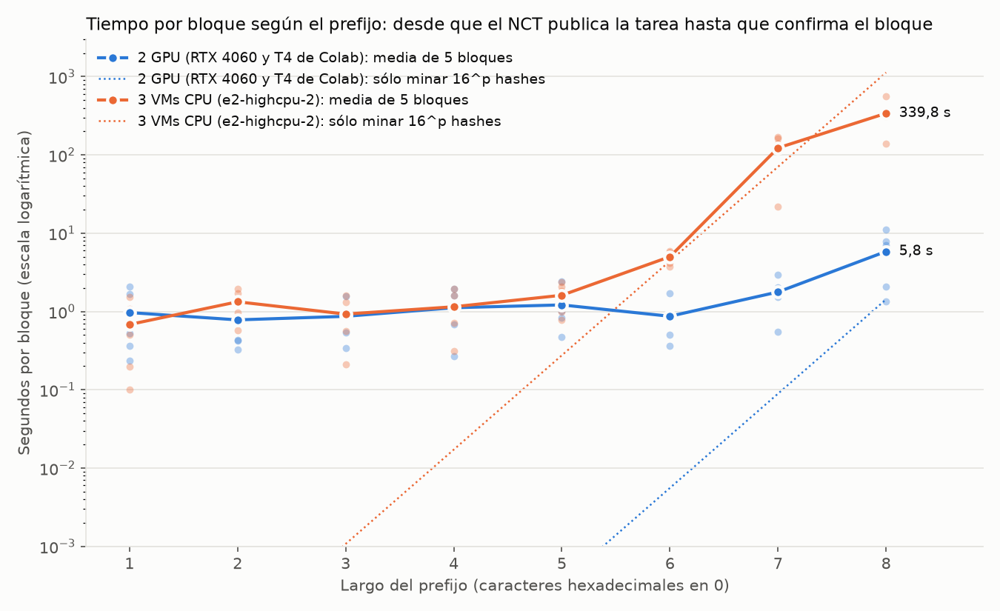
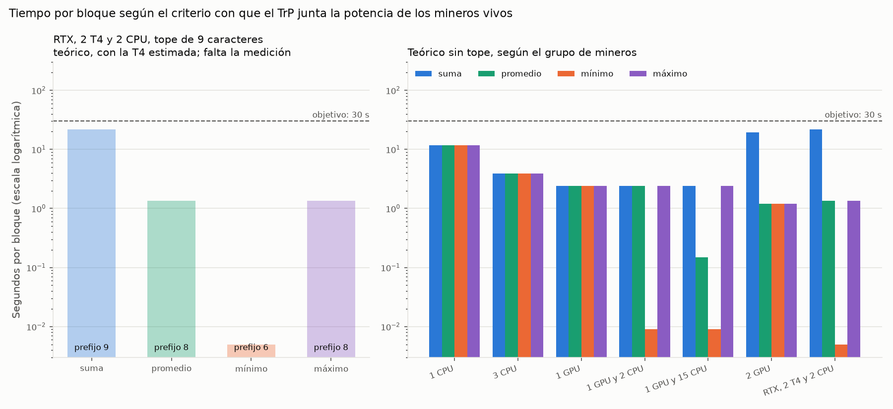
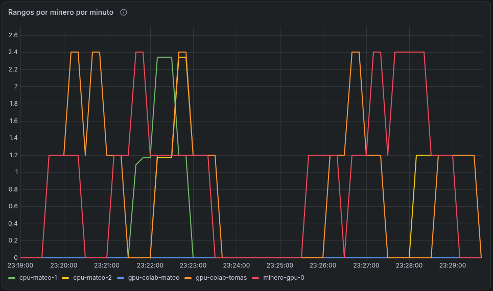

# Pruebas de carga y escalabilidad (BC-38 a BC-42, BC-59)

| Carpeta / archivo | Qué es |
|---|---|
| [`bulks/`](bulks/README.md) | BC-38: bulks de 1 a 100.000 transacciones con k6 |
| [`prefijos.py`](prefijos.py) y `grafico_prefijos.py` | BC-39: prefijo de 1 a 8 caracteres |
| [`fragmentos.py`](fragmentos.py) | BC-40: fragmentación del pool del 1 % al 50 % |
| [`dificultad.py`](dificultad.py) y `grafico_dificultad.py` | BC-60: ajuste de dificultad (convergencia y caída sin GPU) |
| [`potencia_teorica.py`](potencia_teorica.py), [`potencia.py`](potencia.py) y `grafico_potencia.py` | BC-59: criterio de potencia (suma, promedio, mínimo o máximo) |
| [`rafaga.sh`](rafaga.sh) | La ráfaga de la demo: N transferencias firmadas en ronda entre alice, bob y carol, y su seguimiento |
| [`firmar.py`](firmar.py) | Lo que usan las pruebas para firmar: el contrato y las cuentas de prueba del génesis |
| `preparar.sh` | Deja GKE en las condiciones de una prueba y después lo vuelve a la normalidad |

## Preparar GKE: workflow «Pilar 3 · Preparar prueba»

Se corre a mano: **Actions → Pilar 3 · Preparar prueba → Run workflow**. Entra al cluster con la misma cuenta de los pipelines (WIF), corre [`preparar.sh`](preparar.sh) y deja en el resumen la IP pública, la altura de la cadena, los saldos, los mineros vivos y las condiciones del TrP.

| Acción | Qué hace |
|---|---|
| `estado` | Sólo muestra; no cambia nada |
| `preparar` | Fija `PREFIJO_BASE`, `AJUSTAR_PREFIJO`, `FRAGMENTO_PORCENTAJE` y, si se elige, `CRITERIO_POTENCIA` en el TrP (y el mismo prefijo en el escalador). Opcionales: reiniciar la cadena y dejar una cantidad fija de VMs |
| `restaurar` | TrP y escalador como en los manifiestos, y el escalador de nuevo en manos de KEDA |

**Reiniciar la cadena** (escribir `REINICIAR` en el campo): apaga el NCT y el TrP, vacía las colas y Redis, y los vuelve a prender. El NCT carga el génesis con los `SALDOS_INICIALES` de su Deployment, que en GKE son 1.000.000.000 por usuario ([`nct-saldos.yaml`](../k8s/apps/nct-saldos.yaml)). Se pierden todos los bloques y saldos anteriores, para todo el grupo. Se niega si el NCT todavía tiene los saldos por defecto.

**VMs fijas** (`vms_cpu`): pausa el escalador en KEDA (`autoscaling.keda.sh/paused-replicas: "0"`), aplica `vms/instancias` con esa cantidad y espera a que los mineros CPU avisen. Sin esto, el escalador apaga las VMs a los 2 minutos sin trabajo y las vuelve a crear en la corrida siguiente: cambia la cantidad de mineros entre corridas. Si hay una GPU viva, con `vms_cpu` vacío el escalador no levanta ninguna.

Mientras se mide **nadie mergea a `main`**: el Pipeline 3 volvería a aplicar los manifiestos y cambiaría el prefijo en medio de la prueba. Al terminar, `restaurar`.

Desde una PC con `kubectl` apuntando al cluster es lo mismo:

```bash
pilar3/pruebas/preparar.sh estado
pilar3/pruebas/preparar.sh reiniciar
pilar3/pruebas/preparar.sh condiciones 5 0 10        # PREFIJO_BASE, AJUSTAR_PREFIJO, FRAGMENTO_PORCENTAJE
pilar3/pruebas/preparar.sh condiciones 8 1 10 minimo # … y CRITERIO_POTENCIA (BC-59)
PROYECTO=<proyecto de GCP> pilar3/pruebas/preparar.sh fijar-vms 1
pilar3/pruebas/preparar.sh restaurar
```

## Prefijo de 1 a 8 caracteres (BC-39)

[`prefijos.py`](prefijos.py) fija el prefijo del TrP (`PREFIJO_BASE=n`, `AJUSTAR_PREFIJO=0`), manda una transacción por bloque y toma de los logs del NCT el tiempo desde que publica la tarea hasta que confirma el bloque (si la tarea vuelve sin solución, desde la primera publicación). Al terminar deja el TrP como estaba.

```bash
pilar2/.venv/bin/python pilar3/pruebas/prefijos.py --api http://<traefik> --salida resultados/prefijos-gpu.csv
pilar2/.venv/bin/python pilar3/pruebas/prefijos.py --api http://<traefik> --salida resultados/prefijos-cpu.csv --tipo cpu --maximo 600
python pilar3/pruebas/grafico_prefijos.py
```

13/11, 5 bloques por largo: GPU con la RTX 4060 del k3s; CPU con 3 VMs e2-highcpu-2 (el escalador con `PREFIJO_BASE=8` durante la corrida, para que pida el máximo).



| Prefijo | 1 GPU | 3 VMs CPU |
|---|---|---|
| 1 a 5 | 1,3 a 1,7 s | 0,8 a 1,5 s |
| 6 | 1,8 s | 7,3 s |
| 7 | 2,3 s | 72 s |
| 8 | 9,4 s | sin bloque en 600 s |

- Hasta 5 caracteres no se mide el minado sino el resto del sistema (RabbitMQ, TrP, sondeo del minero, confirmación en Redis).
- Con CPU se ve el ×16 por carácter desde el 6; con 8 harían falta ~17 min y el NCT vence la tarea a los 10 (`TAREA_VENCE`).
- Con 8 caracteres hacen falta 16⁸ = 2³² intentos, el mismo tamaño que `ESPACIO_NONCES`: 3 de 8 tareas no tuvieron solución (e⁻¹ ≈ 37 %) y el NCT las rearmó con otro timestamp.

## Fragmentación del 1 % al 50 % (BC-40)

[`fragmentos.py`](fragmentos.py) fija el prefijo (sin ajuste) y recorre `FRAGMENTO_PORCENTAJE` (por defecto 1, 5, 10, 25 y 50). Manda una transacción por bloque y mide:

- de los logs del NCT, el tiempo por bloque, igual que `prefijos.py`;
- de los del TrP, en cuántos rangos se partió la tarea y en cuál cayó el nonce ganador;
- de los del gateway, los rangos prestados (en total y hasta que llegó el ganador), los cortados a medio minar, los descartados sin prestar, los vencidos y cuántos tuvo cada minero.

Al terminar, deja el TrP como estaba.

```bash
pilar2/.venv/bin/python pilar3/pruebas/fragmentos.py --api http://<traefik> --salida pilar3/pruebas/resultados/fragmentos-gpu.csv --prefijo 7
pilar2/.venv/bin/python pilar3/pruebas/fragmentos.py --api http://<traefik> --salida pilar3/pruebas/resultados/fragmentos-cpu.csv --tipo cpu
```

- `prestados_hasta_ganar - 1` es el trabajo desperdiciado, contado en rangos y no en hashes: de un rango cortado no se sabe cuánto se llegó a minar.
- Con `ESPACIO_NONCES = 2^32`, un rango del 1 % tiene ~43 M de nonces. Con prefijo 6 (~16 M intentos), en CPU la solución cae casi siempre en el primer rango que agarra cada minero, así que no se ve la sobrecarga de los rangos chicos. Para verla: GPU con prefijo 7 u 8, o un `--espacio` más chico. Con eso sube la probabilidad de una tarea sin solución, e^(−espacio/16^prefijo).
- En CPU conviene `preparar.sh fijar-vms N` con N ≥ 3: con 50 % hay sólo 2 rangos y se ve un minero sin trabajo.

## Criterio de potencia (BC-59)

El TrP elige el largo p del prefijo con la potencia de los mineros vivos: el mayor p con 16^p ≤ potencia × T (`SEGUNDOS_POR_BLOQUE`), hasta `PREFIJO_BASE`; desde BC-60 ese es el techo del ajuste por tiempo (ver [el README del TrP](../../pilar2/trp/README.md)). La potencia es la **suma** de sus `bench`. `CRITERIO_POTENCIA` permite, sólo para esta prueba, juntarlos con el promedio, el mínimo o el máximo.

Lo importante: **el criterio sólo elige p, pero minan todos**. El bloque tarda en promedio 16^p intentos dividido la potencia **total**, así que la suma es el único criterio que apunta al objetivo. Los otros eligen un p más corto (nunca más largo: el promedio, el mínimo y el máximo son ≤ la suma) y los bloques salen antes de lo buscado.

**Tabla teórica**, sin cluster: [`potencia_teorica.py`](potencia_teorica.py) usa la misma función que el TrP, con los bench de BC-39 (RTX 4060: 1,78 GH/s; VM e2-highcpu-2: 1,44 MH/s) y la T4 de Colab estimada en 700 MH/s (el kernel del Hit 7 en el cierre del Pilar 1), y deja `resultados/potencia-teorica.csv`. La tabla y la medición son con T = 30 s, el objetivo hasta BC-60 (ahora 60 s: algunos grupos suben un carácter). Sin tope:

| Grupo | Suma | Promedio | Mínimo | Máximo |
|---|---|---|---|---|
| 1 CPU | 6 (11,7 s) | 6 (11,7 s) | 6 (11,7 s) | 6 (11,7 s) |
| 3 CPU | 6 (3,9 s) | 6 (3,9 s) | 6 (3,9 s) | 6 (3,9 s) |
| 1 GPU | 8 (2,4 s) | 8 (2,4 s) | 8 (2,4 s) | 8 (2,4 s) |
| 1 GPU y 2 CPU | 8 (2,4 s) | 8 (2,4 s) | **6 (0,009 s)** | 8 (2,4 s) |
| 1 GPU y 15 CPU | 8 (2,4 s) | **7 (0,15 s)** | **6 (0,009 s)** | 8 (2,4 s) |
| 2 GPU | **9 (19 s)** | 8 (1,2 s) | 8 (1,2 s) | 8 (1,2 s) |
| RTX, 2 T4 y 2 CPU (el de la prueba) | **9 (22 s)** | 8 (1,3 s) | **6 (0,005 s)** | 8 (1,3 s) |

- El **mínimo** se separa en cuanto hay una CPU junto a una GPU: el prefijo lo elige el más lento y la GPU lo resuelve enseguida.
- El **promedio** se separa cuando hay muchos mineros: es la suma dividida la cantidad, así que depende de cuántos hay y no de cuánto pueden.
- El **máximo** se separa cuando hay varios mineros fuertes: con 2 GPU elige como si hubiera una.
- En el grupo de la prueba se separan tres: la suma (9), el máximo y el promedio (8) y el mínimo (6). Pasa con cualquier T4 de más de ~0,26 GH/s, así que no depende de la estimación. Sin las CPU, el mínimo sería una T4 y daría 8 como el resto.
- Como p sube de a un carácter (×16), los criterios muchas veces coinciden, y aun con la suma el bloque tarda entre T/16 y T (con 1 GPU, 2,4 s y no 30). Los tiempos teóricos no incluyen el resto del sistema: en BC-39, hasta prefijo 5 un bloque tarda 1 a 2 s igual.

**Medición en GKE**: [`potencia.py`](potencia.py) recorre los criterios con el ajuste prendido (`AJUSTAR_PREFIJO=1`), tope 9, `ESPACIO_NONCES=2^38` (con prefijo 9 hacen falta 2^36 intentos: quedan sin solución ~1,8 % de las tareas en vez de ~37 %) y 10 %, y saca de los logs del TrP el criterio, el prefijo y la potencia de cada tarea. Exige 3 GPU y 2 CPU vivos (`--gpus` y `--cpus` lo cambian). Con un TrP sin `CRITERIO_POTENCIA` (el de `main`), `--emular` lee el `bench` de los vivos de `/api/mineros`, calcula con `trp/particion.py` el prefijo de cada criterio y lo fija (`PREFIJO_BASE=p`, `AJUSTAR_PREFIJO=0`): mide lo mismo, porque minan todos igual. Al terminar deja el TrP como estaba. Con la medición, el gráfico calcula lo teórico con la potencia que registró el TrP (la suma) y no con la T4 estimada.

El grupo: la RTX 4060 del k3s, 2 GPU de Colab ([`colab.ipynb`](../../pilar2/minero_gpu/colab.ipynb), cada una con su cuenta aprobada) y 2 VMs CPU fijas. Conviene hacerla en la misma sesión que BC-40, que con varias GPU también se ve mejor: primero `fragmentos.py --tipo gpu` sin VMs, después las VMs y esta.

```bash
# Con la RTX y los 2 Colab prendidos, y el TrP de BC-59 desplegado en GKE
PROYECTO=<proyecto de GCP> pilar3/pruebas/preparar.sh fijar-vms 2
pilar2/.venv/bin/python pilar3/pruebas/potencia_teorica.py
pilar2/.venv/bin/python pilar3/pruebas/potencia.py --api http://<traefik> --salida pilar3/pruebas/resultados/potencia.csv
#   … --emular si el TrP desplegado no es el de BC-59
python pilar3/pruebas/grafico_potencia.py
pilar3/pruebas/preparar.sh restaurar
```



17/11, en GKE con `--emular` (el TrP de `main`, todavía sin `CRITERIO_POTENCIA`), 5 bloques por criterio, sin rearmados. El grupo, con el `bench` que registró cada uno: la RTX 4060 del k3s (`minero-gpu-0`, 0,69 GH/s, compartida), 2 T4 de Colab (0,94 y 0,98 GH/s) y 2 mineros CPU con 2 procesos cada uno (3,0 y 3,1 MH/s). Potencia total: 2,62 GH/s ([`resultados/potencia.csv`](resultados/potencia.csv)).

| Criterio | Potencia | Prefijo | Teórico (16^p / 2,62 GH/s) | Medido: media (mín. a máx.) |
|---|---|---|---|---|
| suma | 2.615 MH/s | 9 | 26,3 s | **13,6 s** (4,1 a 26,7) |
| promedio | 523 MH/s | 8 | 1,6 s | 2,9 s (1,3 a 4,0) |
| máximo | 981 MH/s | 8 | 1,6 s | 1,9 s (0,8 a 2,9) |
| mínimo | 3 MH/s | 6 | 0,006 s | 0,7 s (0,5 a 0,9) |

- **La suma es la única que se acerca al objetivo de 30 s.** El promedio y el máximo eligen un carácter menos y el bloque sale ~16 veces antes; el mínimo, que lo elige una CPU, tres caracteres menos.
- La media de la suma quedó por debajo de lo teórico: con 5 bloques la dispersión es grande (el tiempo hasta encontrar el nonce es exponencial: 4 a 27 s), no es un sesgo.
- Con el mínimo el bloque no tarda 6 ms sino 0,7 s: es lo que tarda el resto del sistema (publicar la tarea, prestar los rangos, verificar y confirmar), como en BC-39 con prefijos cortos.
- Ganaron las tres GPU, ninguna CPU: con estos prefijos, los rangos que agarran las CPU casi nunca llegan a tener la solución antes que una GPU.

### El reparto de rangos en Grafana

Los paneles «Rangos por minero por minuto» y «Rangos por tipo», de la fila «Reparto del trabajo» del dashboard, cuentan los rangos que el gateway le presta a cada minero (`blockchain_minero_rangos_total`). Capturas del 17/11, de 23:19 a 23:30, en GKE con el código de `dev` y las condiciones normales (prefijo 6 fijo, 10 %). El grupo, con su `bench`: la RTX 4060 del k3s (`minero-gpu-0`, 1,44 GH/s), una T4 de Colab (`gpu-colab-tomas`, 0,98 GH/s) y 2 mineros CPU con 2 procesos cada uno (`cpu-mateo-1` y `cpu-mateo-2`, 3,0 y 3,1 MH/s). `gpu-colab-mateo` estaba apagado. Las transacciones las puso [`rafaga.sh`](rafaga.sh) en loop, de a 500.




- **Las GPU se llevaron 17 rangos y las CPU 8**: el doble, con el mismo número de mineros de cada tipo.
- La diferencia es mucho menor que la de potencia (~400 veces: 2,42 GH/s contra 6,1 MH/s). Lo más probable es que sea por el prefijo corto: el bloque sale en 1 a 2 s, así que casi todo el reparto pasa en el primer pedido de cada tarea, cuando todos agarran uno. Ese rango cuenta al prestarse, aunque la CPU no llegue a terminarlo (el TrP lo descarta con «ya resuelta»). Con un prefijo que tarde más, la GPU volvería a pedir muchas veces antes que la CPU.
- Entre 23:23:40 y 23:25:40 todo está en 0: no hubo transacciones pendientes y el TrP no armó tareas.

## Firmas (contrato v2)

Las transacciones van firmadas por su origen y con el nonce de su cuenta. Las pruebas firman con las cuentas de prueba del génesis (alice, bob y carol, de `pilar2/comun/tests/claves.py`), que en GKE tienen saldos altos ([`nct-saldos.yaml`](../k8s/apps/nct-saldos.yaml)). Por eso se corren con el Python de `pilar2` (`pilar2/.venv/bin/python`, o `pip install -r pilar2/comun/requirements.txt`), que tiene `cryptography`.

La ráfaga de la demo: `pilar3/pruebas/rafaga.sh http://<Ingress> 20`.

## Ajuste de dificultad (BC-60)

[`dificultad.py`](dificultad.py) arranca la cadena con `PREFIJO_INICIAL=2` y `PREFIJO_BASE=8`, espera que el prefijo vaya subiendo de a 1 cada `VENTANA_AJUSTE` bloques hasta acercarse al objetivo de 60 s (`SEGUNDOS_POR_BLOQUE`), y con `--esperar-gpu` pausa para desconectar la GPU y comprobar la bajada inmediata por techo de potencia viva. Al terminar deja el TrP en su configuración normal.

```bash
# Correr con cadena limpia (preparar.sh reiniciar antes)
pilar2/.venv/bin/python pilar3/pruebas/dificultad.py --api http://<traefik> --salida pilar3/pruebas/resultados/dificultad.csv --esperar-gpu
python pilar3/pruebas/grafico_dificultad.py
```
